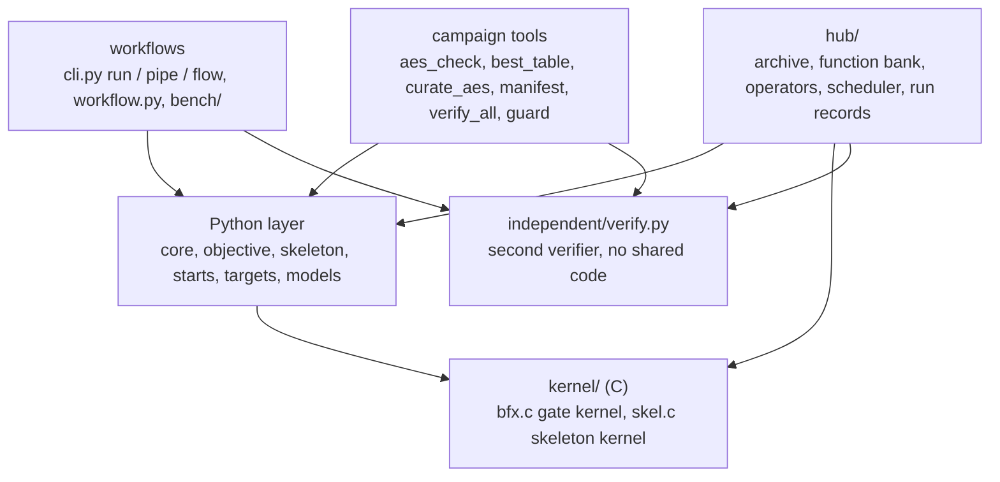

# BoolFlux design: the architecture as built

State of 2026-11-15, commit f9fe6f7 plus the uncommitted study directories. This page replaces
the design notes of 2026-11-13. The targeted campaigns of 2026-11-15/16 added rows to sections
2, 5 and 6 (marked by their date); their methods are in [HOW-IT-WORKS.md](HOW-IT-WORKS.md). It describes what exists, in the order kernel, Python layer,
workflows, hub, campaign tools, and then what was measured to work and what was not.

Marks: **[C]** = counted from run records or exhaustive within the case stated;
**[H]** = interpretation or heuristic finding. Sources are named next to each claim. The two
log analyses this page leans on are `strategies/L2/WHAT-WORKED-BEFORE.md` (everything before the
hub) and `strategies/L1/WHAT-WORKS.md` (the hub runs). How to run things is in
[USAGE.md](USAGE.md); how a result is checked is in [VERIFICATION.md](VERIFICATION.md).

BoolFlux searches for cheaper circuits of a complete multi-output Boolean function (an S-box,
given by its value table) under a configurable gate library, cost model, objective and caps. It
is the nonlinear sibling of XORFlux (`search/`). It keeps XORFlux's working ideas: one chain per
worker that never leaves the space of correct circuits, a remove-and-exactly-repair main move,
neutral plateau moves, restarts from the best, and verified records. Its core is new.

## 1. Representation

- **Circuit** (`core.py`): a straight-line program of two-input gates over `n` inputs. A gate is
  its 4-bit truth table `op` (`f(a,b) = (op >> ((a<<1)|b)) & 1`), so any two-input function can
  be a library member: AND 8, OR 14, XOR 6, XNOR 9, NAND 7, NOR 1, ANDN 4, ORN 13, NOT 3 (unary).
  Every signal carries its complete truth table (`2^n` bits; 4 machine words for an 8-bit
  S-box), so correctness is checked exhaustively at every step. This limits BoolFlux to about
  16 inputs.
- **Bit order**: input `i` is bit `n-1-i` of the input integer and output `j` is bit `m-1-j` of
  the output integer (msb/msb, NIST's AES convention).
- **Formats**: NCFF `.circ.txt` (`core.read_ncff`, `core.write_ncff`) and the kernel text format
  `.bfx` (`core.to_kernel`, `core.from_kernel`).
- **Model** (`models/*.json`): the allowed gate types and their costs (`nist`, `bgc`, `gc6`, `gc`,
  `xag`, `xor`). **Metrics**: G gates, A nonlinear gates, GD gate depth (every gate one level,
  NOT included), AD AND depth. **Caps** on GD, AD, A are hard.
- **Objective and rank** (`objective.py`): a lexicographic key list over `cost, g, a, gd, ad`.
  Every component ranks a circuit the same way:
  `(feasible? 0 : 1, total cap excess, summed path excess, key 1, key 2, ...)`.
- **AND skeleton** (`skeleton.py`): the same function as K products `g_k = L_k * R_k` of affine
  forms over `(1, x, g_<k)`, with every output in the GF(2) span of `(1, x, g)`. Every nonlinear
  two-input gate is `((a^p) & (b^q)) ^ r`, so any circuit maps to a skeleton with K = A.

## 2. The kernels (`kernel/`)

**Gate kernel `bfx.c`** (896 lines). The state is always a correct circuit. A move picks a gate
`s`, computes its exact care set (the inputs on which flipping `s` changes an output, from one
re-simulation of its fanout cone) and its divisors (signals outside that cone), and looks for an
expression of 0 to 3 new library gates over the divisors that equals `s` on the care set:

| level | form | search |
|---|---|---|
| 0 | an existing divisor | scan |
| 1 | `op(d1, d2)`, `NOT d` | all pairs of up to `pdiv` divisors, every library op and orientation |
| 2 | `XOR/XNOR(op(d1,d2), d3)` | hash table of the level-1 values, one lookup per `d3` |
| 2 | `op2(op(d1,d2), d3)`, op2 nonlinear | sampled `d3` and op2; the target for `op(d1,d2)` is derived lane by lane |
| 3 | `XOR/XNOR(op(d1,d2), op'(d3,d4))` | hash lookups over the level-1 table |

Candidates respect the depth caps exactly. Each is rebuilt (dead-gate sweep, structural
hashing, merging of gates with identical complete functions) and ranked. Acceptance: the best
strict improvement; otherwise a random equal candidate (plateau walk); otherwise, at a
temperature on a sawtooth schedule, a worse one with probability `exp(-delta/T)`, never beyond
`max_excess` over the best. After `stall_it` iterations without a new best the chain returns
to its best. The kernel re-simulates every accepted circuit on the complete truth table and
aborts if an output differs (a bug guard, not one of the two verifiers).

Changes since the first version: feasibility-first ranking (review 1, 0640d28); move trace,
ablation switches and the exact linear mode for XOR-only libraries (3a71f0f); the no-op filter
`skip_noop` (7ae20c8), made structural in 0659eb9; strict lexicographic ranking `lex`
(0659eb9); step sizes in model units and key-wise Metropolis for objectives that do not start
with cost (review 4, f8a26e3). [bench/MECHANICS.md](bench/MECHANICS.md) is the line-by-line
description but predates 0659eb9: its sections 2 and 4 describe the old penalty acceptance and
the old no-op test (DOCS-TODO.md item 10).

Two behaviours that matter when reading results (`strategies/L2/WHAT-WORKED-BEFORE.md`
sections 1.2 and 1.4, `strategies/L1/WHAT-WORKS.md` finding 5):

- **[C]** While a start is being repaired the rank is the total cap excess, so excess on one
  cap can be exchanged for excess on another. An A28 circuit under caps A <= 28, GD <= 17 became
  A29 at GD 17 and stayed there.
- **[C]** A run that never becomes feasible still writes its best infeasible circuit. `cli.py`
  marks it `CAPS NOT MET`. The track E drivers and the hub admit any correct circuit by its own
  metrics, and several frontier points arose this way.
- **[C]** The first point means that a stage started above one cap (a pull: start GD above the
  GD cap) may pass through states above the A or AD cap, and `strategies/F/fdrive.py` wrote such
  a state as `best.circ.txt` when it had fewer gates (found by agent P1 on 2026-11-15,
  `strategies/P1/NOTES.md` section 6; `bfx.c` lines 285-292, 1064-1077). The option
  `repair_keep 1` (review 5, off by default) forbids any move that raises the excess of a single
  cap, so from a start inside A/AD no state leaves them. From a start inside all caps the kernel
  never leaves them in either setting. The targeted campaigns ran every kernel call with
  `repair_keep 1` from 18:20 UTC on 2026-11-15; since the user's decision of 23:50 UTC, search
  states may exceed the caps and only the recorded result must be inside the hard limits
  ([results/targets/TARGETS.md](results/targets/TARGETS.md) section 2.1).

**Skeleton kernel `skel.c`** (427 lines). Moves on the AND skeleton that one-gate replacements
cannot make, each verified by Gaussian elimination on complete truth tables: *swap* a leaf
product for any product equal to it modulo the span of the rest; *merge* two leaves into one
product (K drops by one; this is how the 16 schoolbook products of a GF(2^4) multiplication
become 9); *split* (a kick, K + 1); *perturb*. The objective is `K + w_lin * E`, E an unshared
XOR count. `skeleton.synthesize` turns a skeleton back into gates, seeded with the parent
circuit so that an unchanged skeleton rebuilds to exactly the parent (bench/REPORT.md
section 3).

## 3. Python layer and workflows

| file | role |
|---|---|
| `core.py` | circuits, formats, bitsliced evaluation, metrics (first verifier) |
| `objective.py` | objective parsing and the shared rank |
| `skeleton.py` | skeleton extraction, kernel file format, synthesis back to gates (Paar-style greedy, incremental) |
| `starts.py` | naive starts from a value table (`anf`, `anf-or`) |
| `targets.py`, `benchmarks/sboxes.json` | targets: AES computed from FIPS-197, small S-boxes, maj3, fulladd, GF(2^4) mult and inversion |
| `cli.py` | `run` (gate kernel, iteration-budgeted, seeds in parallel), `pipe` (rounds of skeleton search, synthesis and gate search), `flow` (the benchmark's time-sliced workflows), `verify`, `start` |
| `workflow.py` | the time-sliced workflows shared by `cli.py flow` and `bench/bench.py`: `gate`, `full`, rebuild-only, adaptive skeleton share |
| `bench/` | benchmark driver, plans, analysis, the external ABC comparison ([bench/REPORT.md](bench/REPORT.md)) |
| `independent/verify.py` | the second verifier, written from a specification with no shared code |

Every `run`, `pipe` and `flow` writes a run folder with `summary.json` (command, settings,
seeds, code hash, every job's improvements), `src/` and `bin/` (the sources used and the
kernels built from them), and per-job `cfg`, `log`, `start.bfx`, `best.bfx`
([runs/README.md](runs/README.md)).

**Reproducibility [C].** A run that its iteration budget ends is deterministic for a given seed,
settings and code version. Tested on 2026-11-15 on the run behind 28/4/133/20: the binary kept
in its run folder (code b0e56ecb18fe) with a copy of its configuration gives the byte-identical
circuit; the recorded command at f9fe6f7 gives the identical gate list only with
`--set skip_noop=0` and stays at 134 with the default no-op filter (`strategies/L2/NOTES.md`,
check 3). A default that changes the random trajectory breaks replay, so the settings in
`summary.json` and the `src/` and `bin/` snapshot are part of the record, not a convenience. Time-budgeted
runs (`flow`, the strategy drivers, hub jobs) are one-off.

## 4. The hub (`hub/`, [hub/SPEC.md](hub/SPEC.md))

One shared search state per campaign directory that every operator reads and writes.

| part | file | what it is |
|---|---|---|
| archive | `archive.py` | every admitted circuit, content-addressed: `archive/<id>.bfx`, `<id>.json` (id, metrics, counts, parents, operator, settings, seed, run id, code version, CPU and wall time, time of admission). Kept per **cell** (A, AD, GD) with the fewest G, up to 4 distinct circuits; the Pareto front is derived from the cells (`cells.json`, `front.json`). A dominated circuit enters its cell only within 6 gates of a dominating front point (`NEAR_SLACK`), a generator's product within 40 (`GEN_SLACK`, the "nursery") |
| admission | `common.py` | both verifiers on all 256 inputs, NIST library, metrics agreement. Nothing unverified enters the archive |
| function bank | `funcbank.py` | every distinct signal truth table of the archived circuits with its cheapest known levels and cone AND count, tagged with the interface functions (N = x^17, N^-1, N + N^-1, the output span). **[C]** Built on every admission; no operator that reached a frontier admission reads it (join computes the front span directly; `linres`, which does read it, had 10 jobs and 0 frontier admissions) |
| operators | `ops.py`, `op_*.py`, `ops/` | separate programs with one CLI (`--archive --in [--in2] --caps --objective --seed --seconds --out`); they write candidates and a `record.json` and never admit. `polish`: gate kernel under caps, objective `a,ad,cost,gd`. `pull`: the same with one cap lowered (GD by 1-3 with the AD cap dropped, or AD by 1, or A by 1). `join` (`join.py`): front of one circuit, back of another, interface rebuilt as affine combinations. `trb` (`trb_impl.py`): timing-driven rebuild of one XOR region plus a short polish. `osc`: cap relaxed then restored. `gen_skel`: 1-3 skeleton moves, seeded rebuild, short polish. Also written: `gen_joinplus` (a join that adds missing products), `gen_inv3`, `gen_bottom`, `linres` |
| scheduler | `scheduler.py` | one pinned worker per CPU. Epsilon-greedy choice of operator on recent gain per CPU second, target = a front circuit with the fewest attempts by that operator. `control.json` is re-read while running (operator list, seconds, eps, nursery share, AD3 share, ingest globs, newly registered operator scripts); every change is logged in `events.jsonl` |
| run records | `runs/<run_id>.json`, `jobs/`, `stats.jsonl` | one record per job: code version, kernel binary hash, seed, settings, parents, timing, outcome |
| A/B tools | `snapshot.py`, `compare.py`, `compare2.py`, `after_ab.py`, `status.py` | rebuild an archive as of a time T for arms that must start equal; compare arms; apply a pre-registered adoption rule; periodic status |
| tests | `tests/test_hub.py` | a wrong circuit is rejected; a cell keeps the minimum G and persists; join reproduces the 31/5/119/20 transplant; record fields |

`hub/goals.py` and `hub/scheduler_goal.py` (a goal-directed scheduler, agent X2) are uncommitted
work of 2026-11-15 and are not described here.

**The gain rule** (`archive.Archive.gain`): a non-dominated tuple scores 8 / 4 / 2 / 1 if it
lowers A / AD / G / GD against some archived point that is no worse on the other three
coordinates. **[C]** This is not a measure of value. A circuit with more ANDs and fewer gates
always exists to compare against, so the rule scored 51 of the 75 hub-made frontier admissions
as "lowers A" and 22 as "lowers AD", although none lowered the smallest A or AD of a class
(`strategies/L1/WHAT-WORKS.md` finding 1). The bandit's reward and every "gain per CPU-h"
table in `strategies/E/NOTES.md` inherit this. Use `strategies/L1/eval_run.py` (frontier
admissions by AND class, goal-near admissions) to judge a run.

## 5. Campaign tools

| tool | role |
|---|---|
| `campaigns/aes_check.py` | both verifiers plus placement against the pinned NIST set (`published()`: 104 forward circuits at 3d80774, 92 distinct tuples); equality counts as dominated |
| `campaigns/best_table.py`, `pareto_audit.py` | NIST-style tables of all candidates; dominance audit of `results/aes` |
| `campaigns/curate_aes.py`, `manifest.py` | copy new Pareto points into `results/aes` with provenance; write `results/MANIFEST.json`, the NIST-format copies and run the third checker (boolcirc) |
| `campaigns/verify_all.py` | re-verify everything we report or keep, in one command |
| `campaigns/collect.py`, `*.sh`, `*_report.py` | the 2026-11-13 campaigns (frontier, depth chains, small S-boxes) |
| `nonlinear/nist/refresh.py` | check or move the NIST pin ([../nist/PIN.md](../nist/PIN.md)) |
| `~/xs-campaigns/guard/` | `xsrun` (detached job as a systemd user unit, CPU-pinned, memory-capped), `xsfg` (foreground, capped), `xsps`, `memguard` (watchdog). Added after the out-of-memory outage of 2026-11-14 05:09 UTC; every campaign job goes through them |
| `strategies/<ID>/` | one directory per track or agent with its code, NOTES and STATUS; campaign data stays outside the repository ([runs/INDEX.md](runs/INDEX.md)) |
| `campaigns/targets/ledger.py` | the result book of the targeted campaigns: verifies every campaign and archive circuit, classifies strict / tradeoff / other per target from TARGETS.json, keeps the (G, GD) and (A, AD, G, GD) frontiers, compares with the pinned set, records provenance (known / reproduced / new) and audits sidecars ([campaigns/targets/README.md](campaigns/targets/README.md)) |
| `campaigns/targets/ops/` (2026-11-16) | operators with one contract (`--in START --target Txx --seed S --seconds T --out DIR`; limits from TARGETS.json; search states may exceed caps; only verified circuits inside the hard limits are written, each with a sidecar, plus `result.json`): `conjpull.py` (conjugate + staged pulls, M2), `rebase.py` and `bottom.py` (class re-basing; shared rank-1 bottom, M3), `satlns.py` (SAT LNS, M4); shared helpers `common.py` (limits, classification copy, `Recorder` that checks and writes candidates at once) ([ops/NOTES.md](campaigns/targets/ops/NOTES.md)) (final list; `m3common.py` and `m3lib/` are M3's adapter and verbatim copies of the P6 / T3 / P7 code; night jobs per operator: conjpull 1188, rebase 60, bottom 48, satlns 40) |
| `campaigns/targets/runner.py` (2026-11-16) | sequential overnight runner (M2): blocks of one target on all listed CPUs, one `xsrun` job per CPU, rechaining of new frontier points, early stop, ledger after each block, restart from `STATE.json` |
| `campaigns/targets/morning.sh` (2026-11-16) | one command for the morning (L1): ledger, curation into `results/targets/` and `results/aes/`, manifest, BEST.md, `verify_all.py`, `aes_check` of the curated targets, unit tests; `--dry-run` on a copy |

## 6. What was measured

Everything here is about the AES S-box under the NIST model unless stated. Tuples are
A/AD/G/GD.

### 6.1 Works

| mechanism | evidence |
|---|---|
| gate kernel from a naive start on small functions | 23 small S-boxes reach the best published counts, most within seconds ([LEDGER.md](LEDGER.md) section 2, bench/REPORT.md 4.2) **[C]** |
| skeleton merge for AND reduction on small functions | GF(2^4) multiplication 16 -> 9 ANDs; the gate level alone reached 14 (ledger) and a median of 12 (benchmark) **[C]** |
| Paar-style XOR-layer resynthesis from the skeleton, on a naive AES start | median 633 gates in 300 s against 749 for local search alone (bench/REPORT.md 4.3) **[C]** |
| deterministic kernel run under each NIST circuit's own caps | 78 starts, about 8 CPU-h: 28/4/133/20 and five more points still on the 2026-11-14 front; the parent pool of most later joins (L2 section 1.5) **[C]** |
| depth pull at a fixed AND count with AD free, then polish of the pulled circuit | all new A28 points before the hub (7 admitted from 53 pulls); in the hub, pull is in the lineage of 51 of 80 frontier admissions and "pull on a circuit a pull just made" is the best chain step (L2 section 1.1, L1 sections 2.2, 2.3) **[C]** |
| join at the stage interface | the first A31 circuits; 20 new points from a 200 CPU-second sweep over 150 circuits; deterministic, re-run identical 30 of 30 (L2 sections 1.3, 6) **[C]** |
| polish of a fresh structure (a join, pull or gen_skel product) | 11 of 17 frontier points of track E's join arm; in the hub the kernel lowered G in 38 of 41 polishes of gen_skel products and in 0 of 138 polishes of seeds (L2 section 2, L1 section 2.2) **[C]** |
| trb under AD <= 3 | 40/3/174/13 and 38/3/161/14 in about 2 minutes each (`strategies/F/NOTES.md` section 6) **[C]** |
| a constructed stage as a join donor | track F's depth-3 inversion block: 122@GD14 with no search, then in the lineage of 5 of 17 frontier points (L2 section 1.5) **[C]** |
| two verifiers, then `aes_check` against a pinned set | no review or audit found a saved circuit computing the wrong function; the pin correction of 2026-11-13 withdrew 13 of 18 early claims ([HISTORY.md](HISTORY.md)) **[C]** |

Added by the targeted campaigns of 2026-11-15 ([results/targets/TARGETS.md](results/targets/TARGETS.md);
methods in [HOW-IT-WORKS.md](HOW-IT-WORKS.md), "Methods added in the targeted campaigns"):

| mechanism | evidence |
|---|---|
| GF(2^8) conjugation of a start, then staged pulls (gate at a loose GD cap, then mix one or two levels at a time) | T04 32/4/117/19 -> 114/19, 115/18, 117/17 and 113/20; T05 AD4 111/25, 112/22; T07 139/27 -> 139/23, then 138/24 by one more kernel stage **[C]** for the circuits; the lineages plateau after 15-40 CPU-min (7 certified T04 lineages end at 113/20 or 114/19) **[H]** |
| exact level-3 GF(4) class re-basing priced by Kraft sums, depth-feasible hybrid build, kernel | T08 GD 12 reached (181/12) only from a GF(4)-coordinate variant with depth slack; then 168/13 by relax-and-re-base at cap 13 **[C]** for the circuits, **[H]** one success from 8 slack variants |
| shared rank-1 bottom rebuild (annealing with an exact per-output depth check) under a kept front, then polish under cap A | T09 45/4/141/12 -> 39/4/138/12 (no kernel) and 41/4/136/12 **[C]** for the circuits |
| span-pooled SAT LNS, sideways queries | the only T01/T03 gain: 28/5/129/19 from the hub's 130/19; improving queries 2 SAT, 11,419 UNSAT, 452 UNKNOWN **[C]** counts |

**[H]** One pattern runs through the rows from the pull downward: the kernel is a good finisher
and a poor explorer. It pays when it is handed a start that is new (another cap, another
combination of stages, a kicked skeleton) and not when it is handed a published circuit or its
own converged output.

### 6.2 Does not work, or did not in the tests made

| mechanism | evidence | how far the evidence reaches |
|---|---|---|
| kernel polish of mature circuits at their own caps | 0 changes in 52 polishes of published A28 circuits; 9 of 10 main-queue starts unchanged after 1 CPU-h each; hub: 0 of 138 polishes of seeds, and no job lowered G under its own caps for any of 14 mature best tuples (L2 section 3 row 8, L1 finding 3) | decisive **[C]** |
| skeleton moves to save gates on good AES circuits | one move costs +12..+42 gates on the A28 circuit; input skeleton returned in 11 of 12 benchmark cases | decisive for gate count **[C]**. Not a test of "one product fewer on an A28 skeleton" |
| SAT windows that save gates at fixed caps (track D) | 0 of 3,062 recorded windows of 4-9 (one run 5-12) gates; 28 % undecided | decisive for that design **[C]**. The encoding never asked for one AND fewer at a free gate count |
| ejection chains, skeleton kicks (track E M1, M2) | medians 135 against 133 for the control | decisive for gate count on an A36 circuit; one seed on A28 **[C]** |
| per-layer linear resynthesis (`linres`) | each layer of a published AD3 circuit returned at its size; hub: 10 jobs, 0 frontier admissions | decisive per layer; too few hub jobs to say more **[C]** |
| AND distribution, union-graph mapping, exact-function splices (track F) | no depth gain; 169-176-gate covers; 130@15, 127@14 | decisive **[C]** |
| cap repair when the skeleton depth bound misses the cap | GD14 -> 13 in 2 of 35 runs, GD13 -> 12 in 0 of 10 | decisive **[C]** |
| `osc` in the hub | 347 jobs, 9.5 CPU-h, 4 frontier admissions | **[C]**; it was adopted on a 1-CPU-hour arm |
| repeat joins on the same target in the hub | 3,471 jobs, 3 frontier admissions; 1,135 of 1,526 join admissions are equal-tuple copies | **[C]** |
| generic basis search for a product set (track G `nlb`) | solves 4-bit cases at once; 0 of 7 on 8-bit 9-product covers | decisive **[C]** |
| no-op filter as a quality gain | median 133 in both arms, sign test p = 1 | decisive: no effect **[C]** |
| GF(2^8) conjugation on A28 starts (T01, T03) | the identity is the best basis of every A28 start by 4 proxy gates; 9 pipelines 5-9 gates above the archive (`strategies/P1/NOTES.md` section 6) | **[H]** proxy and 9 runs |
| conjugation for depth (T02, T06, T08) | skeleton bound of every conjugate >= the identity's (all 2,040 each) | **[C]** for those circuits |
| kernel polish and conjugates for T05 G < 103 | 21 conjugate lineages settle at 104 (~5 CPU-h) | **[H]**; the exact negatives in case S are listed in HOW-IT-WORKS.md |
| generic SAT for bottom tensor rank / Brent equations / inversion synthesis (P2, P3, P7) | no answer in 2-18 min, not even for known solutions | as encoded, too slow **[C]** run counts |
| oscillating GD12 <-> GD13 with re-basing from parents without depth slack (P6) | plateau 187-188 at GD 12 | **[H]** |

### 6.3 Fewer than 28 ANDs

Nothing reached 27. What exists is of two kinds.

- **Exact results, each inside a stated case.** In the three-stage model (one level of
  products spanning N, a middle on functions of N, a last layer with operands in
  span(x, N, N^-1)): N needs exactly 9 level-1 products; the GF(16) inversion needs exactly 5
  ANDs as a function of N; no 12-member GF(4)-norm last layer exists over the three published
  prefixes for the gammas and the cases (dim Z, rank) that were run; the two published A28
  designs pay their extra AND in different stages (`strategies/C/NOTES.md`,
  `strategies/G/NOTES.md`, `strategies/H1/`) **[C, within those cases]**. These are not lower
  bounds for circuits outside the model.
- **Search.** **[C]** Before the hub no kernel, window or chain run on AES had an AND-first
  objective or an A cap below its start's A, apart from eight 240 s runs from A32 circuits
  (L2 section 0). In the hub, pulls that lower A or AD gave frontier admissions only through
  jobs that ended infeasible, and every one of the 80 frontier admissions is "fewer gates under
  the same caps" (L1 findings 1, 5). Joins cannot do it with a linear interface: no join of the
  150-circuit sweep has fewer than 28 ANDs and none exists between the two published A28
  families (L2 section 1.3). AND-removing windows and AND merge moves were tested in the
  2026-11-15 study (H3, R1, X1): no 27 [H] ([HISTORY.md](HISTORY.md), study phase).
- **Agent Z1 (2026-11-15 targeted campaign, `strategies/Z1/NOTES.md`).** [P] For circuits whose
  last layer is a sink layer over a common core E, the output staircase is m_k = |E| + d_k(code
  of the layer's output-usage matrix), so it adds no constraint beyond |E| + K = A and the image
  arrangement; [C] every file examined (111 staircase files, the hub archive up to A30) is of
  that kind. [C] Under the field maps x -> c x^(2^i) all A28 stage-1 spans fall into one class S9
  (AD5: S9 plus one product), so X1b's 9 + 5 + 14 circuits are H2's AD4-span 9 | 5 | 14 family up
  to symmetry (correction 9 below). [C, each in its member or semi-member model] no 13-member
  layer over S9 with a 5-AND middle, no 12-member layer over S9 with the 6-AND middle, and no
  single AND replacing the parallel last-layer pair of 150 A28 spans or (full operand space,
  2^33 each) of NIST g124 and g128. None of these is a bound outside its model. The user stopped
  27-AND work at 23:50 UTC that day.

### 6.4 Corrections to earlier conclusions

1. **A one-CPU-hour A/B arm is not decisive [C].** Twenty one-CPU one-hour blocks of the same
   hub configuration gave 0, 1, 2, 4 frontier admissions in 11, 5, 3, 1 blocks. The arms that
   led to adopting `osc`, `gen_skel` with the nursery, and the AD3 share differed by 1 against
   2. Those adoptions are not established. **[H]** Use at least 8 CPU-hours per arm
   (L1 finding 10, section 5).
2. **The hub's gain is not a value signal [C]** (section 4 above). Rankings of operators by
   gain per CPU-hour, and the bandit that optimises it, do not follow the user's order
   (#AND, then AND depth, then gates, then gate depth).
3. **CPU did not follow value [C].** Targets with A >= 33 took 54 % of the hub's CPU and gave
   no admission with A <= 32 (L1 finding 6).
4. **The join's advantage was a supply of new starts, not a steady yield [C].** In track E's
   A/B all 26 join admissions came in the first 8.6 minutes; in the hub, later joins on the
   same target almost never paid (L2 section 2, L1 finding 8).
5. **"The kernel cannot remove an AND" was never established.** It rests on eight short runs
   with a cost-first objective (L2 section 3 row 10).
6. **"Every published circuit computes the same interface functions" is wrong for the
   inversion [C].** All 101 analysed pinned circuits span N at level 1, but explicit N^-1
   signals exist only in the Boyar-Peralta family (53 circuits) and one A29 circuit. The join
   works where both parents have them (`strategies/L2/DOC-AUDIT.md` W1).
7. **An iteration-budgeted command alone does not reproduce an older result [C]**: it needs the
   settings of its time (`skip_noop=0` for runs before 7ae20c8) or its code snapshot
   (section 3 above).
8. **Timings across CPUs are not comparable [H].** CPUs 12-19 of the machine are probably
   efficiency cores; time-budgeted jobs there do fewer iterations (DOC-AUDIT U8).
9. **X1b's "new A28 family 9 + 5 + 14" is not independent of H2's [C].** `strategies/X1/NOTES.md`
   section 8 calls it new because its span hash and U subspace were not in X1b's registry; that
   registry does not identify spans under the maps x -> c x^(2^i). Under those maps both X1b
   prefixes are images of the AD4 9-spans of NIST g131, g141 and g176, and gen13 over them at
   K = 14 gives exactly H2's AD4 numbers (4,676 candidates, 69 covering layers)
   (`strategies/Z1/NOTES.md` section 2b). What stays true: no published circuit has the
   9 + 5 + 14 split, and X1b's walk reached such circuits by search from the AD5 circuits NIST
   g128 and g124.
10. **Kernel repairs can leave the A and AD caps [C]** (section 2): a recorded circuit inside the
    caps does not mean its search path stayed inside them. The targeted campaigns certified
    the path of every new strict and tradeoff result until the user's decision of 2026-11-15 23:50 UTC made the
    hard limits apply to recorded results only.

## 7. Verification

Inside the search the kernels check every move on complete truth tables. A reported circuit is
checked by two independent implementations, `core` and `independent/verify.py`: both must accept
the function on every input, the circuit must use only the model's gates and meet the stated
caps, and the two metric computations must agree. AES results are then placed against the
pinned NIST set with `campaigns/aes_check.py`, and the NIST-format copies are checked by a third
implementation (boolcirc). `campaigns/verify_all.py` repeats all of it in one command. The hub
runs the same two verifiers at admission. Details and counting rules:
[VERIFICATION.md](VERIFICATION.md). Reviews: `review/`, `review2/`, `review3/`, `review4/`,
`audit/`.
