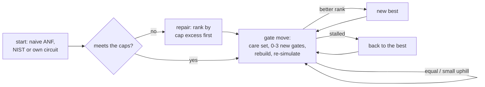
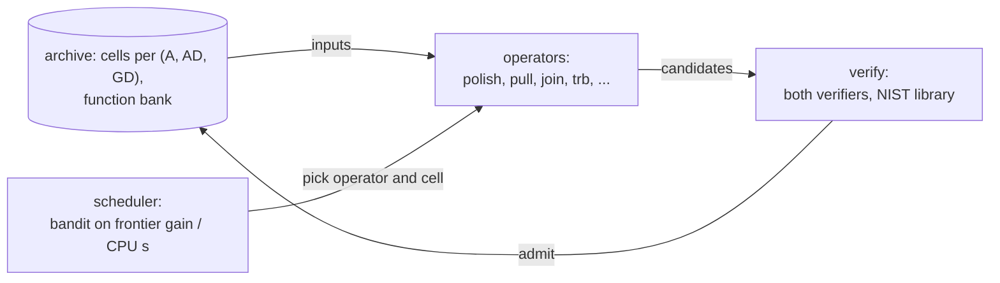

# How BoolFlux works

BoolFlux looks for small circuits of complete Boolean functions, such as S-boxes, over a chosen
gate library, then for low depth or few ANDs, under hard caps. This page explains the method in
plain language. How to run it is in [USAGE.md](USAGE.md). The code-level description, with line
references, is [bench/MECHANICS.md](bench/MECHANICS.md). Where the ideas came from is in
[HISTORY.md](HISTORY.md).

## A circuit is a list of gates with complete truth tables

A circuit is a straight-line program of two-input gates over `n` inputs. Each gate is stored as
its 4-bit truth table, so any two-input function can be in the library: AND, OR, XOR, XNOR, NAND,
NOR, ANDN, ORN, and NOT. Every signal also carries its **complete truth table**, which is `2^n`
bits (4 machine words for an 8-bit S-box). Correctness is therefore never estimated: after every
change the outputs are compared with the target on every input. This limits BoolFlux to about 16
inputs. XOR-only libraries use an exact linear mode that needs only `n + 1` patterns.

A **model** is the library plus a cost per gate type. The **metrics** are G (gates), A (nonlinear
gates), GD (gate depth: every gate is one level) and AD (AND depth). The objective is a
lexicographic list of up to three of `cost, g, a, gd, ad`, and the caps on GD, AD and A are hard.

## The gate move: replace one gate where it matters

One move of the gate kernel ([kernel/bfx.c](kernel/bfx.c)) works like this:

1. Pick a gate `s`. Flip its truth table and re-simulate everything it feeds. The inputs on
   which some output changes form its **care set**: on every other input, `s` may be anything.
2. Look for an expression of 0 to 3 new library gates, built from signals that `s` does not feed
   (so no cycle can form), that equals `s` **on the care set**. The candidates are an existing
   signal, `op(d1, d2)`, `XOR(op(d1, d2), d3)`, `op2(op(d1, d2), d3)` and
   `XOR(op(d1, d2), op'(d3, d4))`, found by hash lookups over pair values. The expression must
   not arrive later than the depth caps allow at `s`.
3. Put the expression in place of `s`. The gates that only `s` needed die. Rebuild the circuit:
   sweep dead gates, hash equal structures, and merge gates with identical complete functions.
   Re-simulate it on all inputs. Every output is unchanged by construction, and the check
   confirms it (a mismatch aborts the kernel).

Because the replacement may be an AND of different operands, XORs in place of an AND, or one AND
in place of a cone of several, this move changes the **nonlinear structure**, not only the XOR
layers. In a traced AES run from NIST's a36-ad4-g142-gd13, 10 improving moves reached 131
gates. Two of them changed AND gates ([bench/REPORT.md](bench/REPORT.md) section 2).

## Acceptance: feasible first, then the keys in order

Every candidate is ranked the same way, in the kernel, the CLI and the workflows
([objective.py](objective.py)):

```
rank = (feasible? 0 : 1,  total cap excess,  summed path excess,  key 1,  key 2,  key 3)
```

A move is taken if it is the best strict improvement in rank. Otherwise BoolFlux takes a random
equal candidate (a plateau walk), or, at a temperature on a sawtooth schedule, a worse one with
probability `exp(-delta / T)`, but never more than `max_excess` above the best. A feasible state
is never left for an infeasible one, so from a feasible state a cap can never be traded for a
lower objective. A start that breaks a cap is **repaired**: its moves are ranked by how much
they reduce the excess, and the "summed path excess" lets a move count as progress when it
shortens a too-deep path before the maximum depth drops. Two things follow that a reader of
results must know. During a repair the rank is the *total* excess, so excess on one cap can be
exchanged for excess on another: an A28 circuit under caps A <= 28, GD <= 17 became an A29
circuit at GD 17. And a run that never becomes feasible still writes its best infeasible
circuit (`cli.py` marks it `CAPS NOT MET`). The track E and hub drivers admitted such circuits
by their own metrics, and several frontier points arose that way (29/5/135/17 before the hub;
the 29/4 and 30/4 families in the hub, `strategies/L1/WHAT-WORKS.md` finding 5). After `stall_it`
iterations without a new best, the chain returns to its best. With an iteration budget, a run
is deterministic for a given seed, settings and code version; see
[VERIFICATION.md](VERIFICATION.md) section 6 for what was re-run.



## The skeleton level, and why it fails on AES

Any circuit can be read as an **AND skeleton**: K products `g_k = L_k * R_k` of affine forms over
the inputs and earlier products, with every output in their linear span. The skeleton kernel
([kernel/skel.c](kernel/skel.c)) moves several ANDs at once, which one-gate moves cannot do: it
*swaps* a product for any other that is equal modulo the rest of the span, *merges* two products
into one, and *splits* or perturbs a product. Gaussian elimination over complete truth tables
checks every move. The skeleton is then turned back into gates, preferably seeded with the parent
circuit so that unchanged parts are copied, and the gate kernel optimises the result under the
real model. `cli.py pipe` alternates the two levels.

It works on small functions. GF(2^4) multiplication drops from 16 to 9 ANDs, the bilinear
complexity. The gate level alone reached 14 ANDs in the ledger run ([LEDGER.md](LEDGER.md)
section 1, 17 s) and a median of 12 in the 60 s benchmark runs
([bench/REPORT.md](bench/REPORT.md) section 4.2); it did not reach 9. On good AES
circuits the skeleton level fails as a way to save gates, for a measured reason: changing one AND
changes every XOR cone that reads it. After the seeded rebuild, one skeleton move costs +12 to
+42 gates on NIST's A28 circuit and +0 to +19 on the 104 (`strategies/E/NOTES.md`), and short
polishes did not recover the loss. The skeleton kernel returned its input skeleton in 11 of 12
AES benchmark cases (REPORT sections 1 and 4.3). Those cases started from A32-A36 circuits and
scored `K + 0.02 E` inside 120 s runs. No run searched for one product fewer on an A28 skeleton
with gate count ignored, so this is not evidence about 27 ANDs
(`strategies/L2/WHAT-WORKED-BEFORE.md` section 3, row 9).

## Joining at interface functions

Every pinned AES circuit spans the GF(2^4) norm `N = x^17` with its level-1 ANDs (9-11 of them
in 99 of the 101 circuits analysed, 17 and 18 in the A59 and A60 circuits). The Boyar-Peralta
family (all 53 circuits with A32-A53 and AND depth >= 4) then computes `N^-1` as explicit signals
after 15-21 ANDs. The other families do not: no A28, A30 or AND-depth-3 circuit and only one of
the 15 A29 circuits has such signals; their later ANDs read forms that mix x with functions of N
(`strategies/E/analyze_stages.py`; counts in `strategies/L2/DOC-AUDIT.md` W1). These functions
do not depend on the tower-field basis, so where two circuits both have them, the **front** of
one and the **back** of the other meet there, up to a linear interface. A **join** (track E's
`splice2.py`) does three things:

1. It keeps circuit X up to AND level LX, and circuit Y above AND level LY.
2. It rebuilds the signals that Y's back reads as affine combinations of X's front signals, by
   Gaussian elimination, from X's existing linear signals.
3. It removes dead gates and checks the result on all 256 inputs.

Different circuits optimise different stages for different (A, GD) trade-offs, so a join can
reach points that neither parent nor the gate kernel reaches. The first A31 circuits came from
one join (A32 front cut at AND level 4, A32 back above level 3), and the gate kernel did not
remove an AND from the two A32 parents in 8 runs of 240 s (cap A31, objective `cost,gd`).
In the final A/B, join + polish gave 17 frontier points and polish alone gave 3, in the same
4.7 CPU-hours ([HISTORY.md](HISTORY.md), track E). All 26 join admissions of that arm came in
its first 8.6 minutes; 14 of the 17 points are those joins or polishes of them. What the join
supplies is new starting points for the kernel, not a steady yield. A join is a deterministic
construction: the 30 recorded joins of track E were re-run on 2026-11-15 with identical output.
Polishing its output with the gate kernel then lowers G and GD further.

What joins did not do: in the sweep over 150 circuits (24,443 distinct results) no join has
fewer than 28 ANDs, the only results below 32 that undercut both parents are the A32 x A32 -> A31
ones, and there is no valid join between the two published A28 families (AND depth 4 and 5)
(`strategies/L2/WHAT-WORKED-BEFORE.md` section 1.3).

## Verification

The kernel's re-simulation guards the search. A result counts only after two independent
verifiers (`core` and `independent/verify.py`, each with its own AES table) accept it on every
input, agree on every metric, and confirm the library and the caps. AES results are then placed
against the pinned NIST set with `campaigns/aes_check.py`. Details:
[VERIFICATION.md](VERIFICATION.md).

## The hub

> The hub was built on 2026-11-14 ([hub/SPEC.md](hub/SPEC.md)) and ran for 65.9 CPU-hours that
> evening. The results quoted elsewhere on this page are from before it. (Re-curated
> 2026-11-15.) Its circuits entered the result tables at the curation of 2026-11-15 06:53 UTC:
> 36 MANIFEST.json entries with track `hub`, all on the Pareto front of 73 tuples
> ([results/BEST.md](results/BEST.md), [README.md](README.md)). What it was measured to do and
> not to do is in [DESIGN.md](DESIGN.md) section 6, from `strategies/L1/WHAT-WORKS.md`.

The hub replaces separate strategy scripts with one shared search state that every operator
reads and writes:

- an **archive** of verified circuits (content-addressed, with parents, operator, seed and code
  version), kept per **cell** `(A, AD, GD)` with the fewest G, so AND count and AND depth are
  coordinates in their own right, not tie-breakers;
- a **function bank** of every signal truth table that occurs, tagged with the interface
  functions (N, N^-1, N + N^-1, the outputs);
- **operators** that own no circuit: `polish` (gate kernel under caps), `pull` (polish with one
  cap lowered), `join`, `trb` (timing-aware rebuild of one XOR region), `osc` (cap relaxed, then
  restored) and `gen_skel` (a skeleton kick followed by a short polish). `linres` and three
  other generators were written and sampled 5-21 times each, with no frontier admission;
- a **bandit scheduler** that gives CPU to the operators with recent "gain" per CPU second.

Two cautions from the log analysis [counted, `strategies/L1/WHAT-WORKS.md` findings 1, 2, 10].
All 80 frontier admissions of the hub runs are "fewer gates under the same caps"; none lowered
the smallest A or AD of a class, and no goal box was met. And the gain that the scheduler
rewards is not a measure of value: it scored 51 of the 75 hub-made admissions as "lowers A",
because a circuit with more ANDs and fewer gates always exists to compare with. The operator
choices made that evening rest on one-CPU-hour arms that differed by 1 against 2 admissions,
which is within noise.


