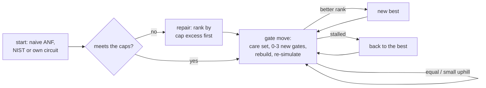
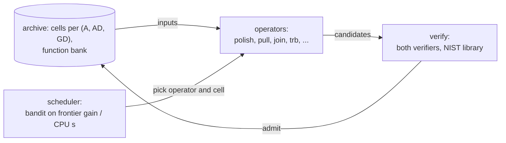

# How BoolFlux works

BoolFlux looks for small circuits of complete Boolean functions, such as S-boxes, over a chosen
gate library, then for low depth or few ANDs, under hard caps. This page explains the method in
plain language. How to run it is in [USAGE.md](USAGE.md). The code-level description, with line
references, is [bench/MECHANICS.md](bench/MECHANICS.md). Where the ideas came from is in
[HISTORY.md](HISTORY.md).

## A circuit is a list of gates with complete truth tables

A circuit is a straight-line program of two-input gates over `n` inputs. Each gate is stored as
its 4-bit truth table, so any two-input function can be in the library: AND, OR, XOR, XNOR, NAND,
NOR, ANDN, ORN, and NOT. Every signal also carries its **complete truth table**, which is `2^n`
bits (4 machine words for an 8-bit S-box). Correctness is therefore never estimated: after every
change the outputs are compared with the target on every input. This limits BoolFlux to about 16
inputs. XOR-only libraries use an exact linear mode that needs only `n + 1` patterns.

A **model** is the library plus a cost per gate type. The **metrics** are G (gates), A (nonlinear
gates), GD (gate depth: every gate is one level) and AD (AND depth). The objective is a
lexicographic list of up to three of `cost, g, a, gd, ad`, and the caps on GD, AD and A are hard.

## The gate move: replace one gate where it matters

One move of the gate kernel ([kernel/bfx.c](kernel/bfx.c)) works like this:

1. Pick a gate `s`. Flip its truth table and re-simulate everything it feeds. The inputs on
   which some output changes form its **care set**: on every other input, `s` may be anything.
2. Look for an expression of 0 to 3 new library gates, built from signals that `s` does not feed
   (so no cycle can form), that equals `s` **on the care set**. The candidates are an existing
   signal, `op(d1, d2)`, `XOR(op(d1, d2), d3)`, `op2(op(d1, d2), d3)` and
   `XOR(op(d1, d2), op'(d3, d4))`, found by hash lookups over pair values. The expression must
   not arrive later than the depth caps allow at `s`.
3. Put the expression in place of `s`. The gates that only `s` needed die. Rebuild the circuit:
   sweep dead gates, hash equal structures, and merge gates with identical complete functions.
   Re-simulate it on all inputs. Every output is unchanged by construction, and the check
   confirms it (a mismatch aborts the kernel).

Because the replacement may be an AND of different operands, XORs in place of an AND, or one AND
in place of a cone of several, this move changes the **nonlinear structure**, not only the XOR
layers. In a traced AES run from NIST's a36-ad4-g142-gd13, 10 improving moves reached 131
gates. Two of them changed AND gates ([bench/REPORT.md](bench/REPORT.md) section 2).

## Acceptance: feasible first, then the keys in order

Every candidate is ranked the same way, in the kernel, the CLI and the workflows
([objective.py](objective.py)):

```
rank = (feasible? 0 : 1,  total cap excess,  summed path excess,  key 1,  key 2,  key 3)
```

A move is taken if it is the best strict improvement in rank. Otherwise BoolFlux takes a random
equal candidate (a plateau walk), or, at a temperature on a sawtooth schedule, a worse one with
probability `exp(-delta / T)`, but never more than `max_excess` above the best. A feasible state
is never left for an infeasible one, so a cap can never be traded for a lower objective. A start
that breaks a cap is **repaired**: its moves are ranked by how much they reduce the excess, and
the "summed path excess" lets a move count as progress when it shortens a too-deep path before
the maximum depth drops. After `stall_it` iterations without a new best, the chain returns to
its best. With an iteration budget, the whole run is deterministic for a given seed.



## The skeleton level, and why it fails on AES

Any circuit can be read as an **AND skeleton**: K products `g_k = L_k * R_k` of affine forms over
the inputs and earlier products, with every output in their linear span. The skeleton kernel
([kernel/skel.c](kernel/skel.c)) moves several ANDs at once, which one-gate moves cannot do: it
*swaps* a product for any other that is equal modulo the rest of the span, *merges* two products
into one, and *splits* or perturbs a product. Gaussian elimination over complete truth tables
checks every move. The skeleton is then turned back into gates, preferably seeded with the parent
circuit so that unchanged parts are copied, and the gate kernel optimises the result under the
real model. `cli.py pipe` alternates the two levels.

It works on small functions. GF(2^4) multiplication drops from 16 to 9 ANDs, the bilinear
complexity, and the gate level alone stops at 14 ([LEDGER.md](LEDGER.md) section 1). On good AES
circuits it fails, for a measured reason: changing one AND changes every XOR cone that reads it.
After the seeded rebuild, one skeleton move costs +12 to +42 gates on NIST's A28 circuit and +0
to +19 on the 104 (`strategies/E/NOTES.md`), and short polishes did not recover the loss. The
skeleton objective found no improving move in 11 of 12 AES cases (REPORT section 3). AND
structure on AES is therefore changed by the gate move and by joins, not by skeleton moves.

## Joining at interface functions

Every published AES circuit computes the same intermediate functions. After 9-11 level-1 ANDs,
the GF(2^4) norm `N = x^17` lies in its linear span, and the inversion block's outputs follow.
These functions do not depend on the tower-field basis, so the **front** of one circuit and the
**back** of another meet at them, up to a linear interface. A **join** (track E's `splice2.py`)
does three things:

1. It keeps circuit X up to AND level LX, and circuit Y above AND level LY.
2. It rebuilds the signals that Y's back reads as affine combinations of X's front signals, by
   Gaussian elimination, from X's existing linear signals.
3. It removes dead gates and checks the result on all 256 inputs.

Different circuits optimise different stages for different (A, GD) trade-offs, so a join can
reach points that neither parent nor the gate kernel reaches. The first A31 circuits came from
one join, and the gate kernel cannot remove an AND from the A32 parents (0 of 8 polishes did).
In the final A/B, join + polish gave 17 frontier points and polish alone gave 3, in the same
4.7 CPU-hours ([HISTORY.md](HISTORY.md), track E). A join is a deterministic construction.
Polishing its output with the gate kernel then lowers G and GD further.

## Verification

The kernel's re-simulation guards the search. A result counts only after two independent
verifiers (`core` and `independent/verify.py`, each with its own AES table) accept it on every
input, agree on every metric, and confirm the library and the caps. AES results are then placed
against the pinned NIST set with `campaigns/aes_check.py`. Details:
[VERIFICATION.md](VERIFICATION.md).

## The hub (in progress)

> This section describes [hub/SPEC.md](hub/SPEC.md) as of 2026-11-14. The hub is being built
> while this is written, and no result on this page comes from it.

The hub replaces separate strategy scripts with one shared search state that every operator
reads and writes:

- an **archive** of verified circuits (content-addressed, with parents, operator, seed and code
  version), kept per **cell** `(A, AD, GD)` with the fewest G, so AND count and AND depth are
  coordinates in their own right, not tie-breakers;
- a **function bank** of every signal truth table that occurs, tagged with the interface
  functions (N, N^-1, N + N^-1, the outputs);
- **operators** that own no circuit: `polish` (gate kernel under caps), `pull` (polish with one
  cap lowered), `join`, `trb` (timing-aware rebuild of one XOR region), and later `linres` and
  nonlinear-structure **generators**;
- a **bandit scheduler** that gives CPU to the operators with recent frontier gain per CPU
  second, favouring lower A and AD.


