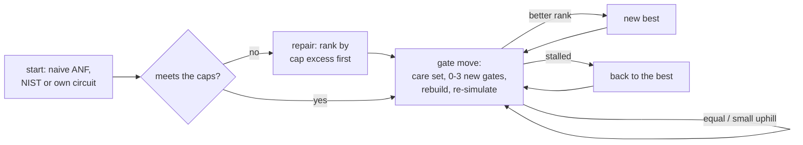
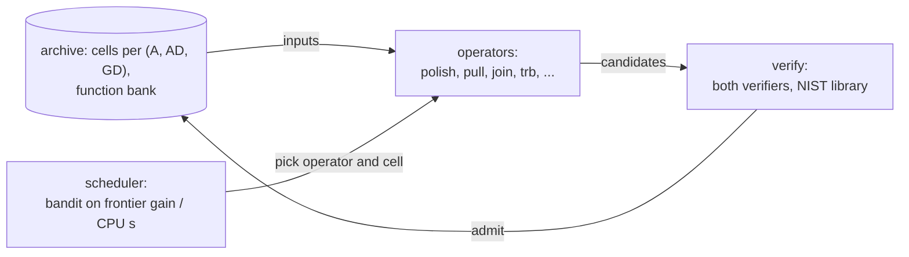

# How BoolFlux works

BoolFlux looks for small circuits of complete Boolean functions, such as S-boxes, over a chosen
gate library, then for low depth or few ANDs, under hard caps. This page explains the method in
plain language. How to run it is in [USAGE.md](USAGE.md). The code-level description, with line
references, is [bench/MECHANICS.md](bench/MECHANICS.md). Where the ideas came from is in
[HISTORY.md](HISTORY.md).

## A circuit is a list of gates with complete truth tables

A circuit is a straight-line program of two-input gates over `n` inputs. Each gate is stored as
its 4-bit truth table, so any two-input function can be in the library: AND, OR, XOR, XNOR, NAND,
NOR, ANDN, ORN, and NOT. Every signal also carries its **complete truth table**, which is `2^n`
bits (4 machine words for an 8-bit S-box). Correctness is therefore never estimated: after every
change the outputs are compared with the target on every input. This limits BoolFlux to about 16
inputs. XOR-only libraries use an exact linear mode that needs only `n + 1` patterns.

A **model** is the library plus a cost per gate type. The **metrics** are G (gates), A (nonlinear
gates), GD (gate depth: every gate is one level) and AD (AND depth). The objective is a
lexicographic list of up to three of `cost, g, a, gd, ad`, and the caps on GD, AD and A are hard.

## The gate move: replace one gate where it matters

One move of the gate kernel ([kernel/bfx.c](kernel/bfx.c)) works like this:

1. Pick a gate `s`. Flip its truth table and re-simulate everything it feeds. The inputs on
   which some output changes form its **care set**: on every other input, `s` may be anything.
2. Look for an expression of 0 to 3 new library gates, built from signals that `s` does not feed
   (so no cycle can form), that equals `s` **on the care set**. The candidates are an existing
   signal, `op(d1, d2)`, `XOR(op(d1, d2), d3)`, `op2(op(d1, d2), d3)` and
   `XOR(op(d1, d2), op'(d3, d4))`, found by hash lookups over pair values. The expression must
   not arrive later than the depth caps allow at `s`.
3. Put the expression in place of `s`. The gates that only `s` needed die. Rebuild the circuit:
   sweep dead gates, hash equal structures, and merge gates with identical complete functions.
   Re-simulate it on all inputs. Every output is unchanged by construction, and the check
   confirms it (a mismatch aborts the kernel).

Because the replacement may be an AND of different operands, XORs in place of an AND, or one AND
in place of a cone of several, this move changes the **nonlinear structure**, not only the XOR
layers. In a traced AES run from NIST's a36-ad4-g142-gd13, 10 improving moves reached 131
gates. Two of them changed AND gates ([bench/REPORT.md](bench/REPORT.md) section 2).

## Acceptance: feasible first, then the keys in order

Every candidate is ranked the same way, in the kernel, the CLI and the workflows
([objective.py](objective.py)):

```
rank = (feasible? 0 : 1,  total cap excess,  summed path excess,  key 1,  key 2,  key 3)
```

A move is taken if it is the best strict improvement in rank. Otherwise BoolFlux takes a random
equal candidate (a plateau walk), or, at a temperature on a sawtooth schedule, a worse one with
probability `exp(-delta / T)`, but never more than `max_excess` above the best. A feasible state
is never left for an infeasible one, so from a feasible state a cap can never be traded for a
lower objective. A start that breaks a cap is **repaired**: its moves are ranked by how much
they reduce the excess, and the "summed path excess" lets a move count as progress when it
shortens a too-deep path before the maximum depth drops. Two things follow that a reader of
results must know. During a repair the rank is the *total* excess, so excess on one cap can be
exchanged for excess on another: an A28 circuit under caps A <= 28, GD <= 17 became an A29
circuit at GD 17. And a run that never becomes feasible still writes its best infeasible
circuit (`cli.py` marks it `CAPS NOT MET`). The track E and hub drivers admitted such circuits
by their own metrics, and several frontier points arose that way (29/5/135/17 before the hub;
the 29/4 and 30/4 families in the hub, `strategies/L1/WHAT-WORKS.md` finding 5). After `stall_it`
iterations without a new best, the chain returns to its best. With an iteration budget, a run
is deterministic for a given seed, settings and code version; see
[VERIFICATION.md](VERIFICATION.md) section 6 for what was re-run.



## The skeleton level, and why it fails on AES

Any circuit can be read as an **AND skeleton**: K products `g_k = L_k * R_k` of affine forms over
the inputs and earlier products, with every output in their linear span. The skeleton kernel
([kernel/skel.c](kernel/skel.c)) moves several ANDs at once, which one-gate moves cannot do: it
*swaps* a product for any other that is equal modulo the rest of the span, *merges* two products
into one, and *splits* or perturbs a product. Gaussian elimination over complete truth tables
checks every move. The skeleton is then turned back into gates, preferably seeded with the parent
circuit so that unchanged parts are copied, and the gate kernel optimises the result under the
real model. `cli.py pipe` alternates the two levels.

It works on small functions. GF(2^4) multiplication drops from 16 to 9 ANDs, the bilinear
complexity. The gate level alone reached 14 ANDs in the ledger run ([LEDGER.md](LEDGER.md)
section 1, 17 s) and a median of 12 in the 60 s benchmark runs
([bench/REPORT.md](bench/REPORT.md) section 4.2); it did not reach 9. On good AES
circuits the skeleton level fails as a way to save gates, for a measured reason: changing one AND
changes every XOR cone that reads it. After the seeded rebuild, one skeleton move costs +12 to
+42 gates on NIST's A28 circuit and +0 to +19 on the 104 (`strategies/E/NOTES.md`), and short
polishes did not recover the loss. The skeleton kernel returned its input skeleton in 11 of 12
AES benchmark cases (REPORT sections 1 and 4.3). Those cases started from A32-A36 circuits and
scored `K + 0.02 E` inside 120 s runs. No run searched for one product fewer on an A28 skeleton
with gate count ignored, so this is not evidence about 27 ANDs
(`strategies/L2/WHAT-WORKED-BEFORE.md` section 3, row 9).

## Joining at interface functions

Every pinned AES circuit spans the GF(2^4) norm `N = x^17` with its level-1 ANDs (9-11 of them
in 99 of the 101 circuits analysed, 17 and 18 in the A59 and A60 circuits). The Boyar-Peralta
family (all 53 circuits with A32-A53 and AND depth >= 4) then computes `N^-1` as explicit signals
after 15-21 ANDs. The other families do not: no A28, A30 or AND-depth-3 circuit and only one of
the 15 A29 circuits has such signals; their later ANDs read forms that mix x with functions of N
(`strategies/E/analyze_stages.py`; counts in `strategies/L2/DOC-AUDIT.md` W1). These functions
do not depend on the tower-field basis, so where two circuits both have them, the **front** of
one and the **back** of the other meet there, up to a linear interface. A **join** (track E's
`splice2.py`) does three things:

1. It keeps circuit X up to AND level LX, and circuit Y above AND level LY.
2. It rebuilds the signals that Y's back reads as affine combinations of X's front signals, by
   Gaussian elimination, from X's existing linear signals.
3. It removes dead gates and checks the result on all 256 inputs.

Different circuits optimise different stages for different (A, GD) trade-offs, so a join can
reach points that neither parent nor the gate kernel reaches. The first A31 circuits came from
one join (A32 front cut at AND level 4, A32 back above level 3), and the gate kernel did not
remove an AND from the two A32 parents in 8 runs of 240 s (cap A31, objective `cost,gd`).
In the final A/B, join + polish gave 17 frontier points and polish alone gave 3, in the same
4.7 CPU-hours ([HISTORY.md](HISTORY.md), track E). All 26 join admissions of that arm came in
its first 8.6 minutes; 14 of the 17 points are those joins or polishes of them. What the join
supplies is new starting points for the kernel, not a steady yield. A join is a deterministic
construction: the 30 recorded joins of track E were re-run on 2026-11-15 with identical output.
Polishing its output with the gate kernel then lowers G and GD further.

What joins did not do: in the sweep over 150 circuits (24,443 distinct results) no join has
fewer than 28 ANDs, the only results below 32 that undercut both parents are the A32 x A32 -> A31
ones, and there is no valid join between the two published A28 families (AND depth 4 and 5)
(`strategies/L2/WHAT-WORKED-BEFORE.md` section 1.3).

## Methods added in the targeted campaigns (2026-11-15)

The ten targeted campaigns ([results/targets/TARGETS.md](results/targets/TARGETS.md)) produced
their new points with four methods that sit around the gate kernel rather than inside it. Each
hands the kernel a start it has not seen (another linear basis, another bottom, another set of
level-3 products), in line with the finding that the kernel is a good finisher and a poor
explorer ([DESIGN.md](DESIGN.md) section 6.1). Labels as in DESIGN.md: [C] exact within the
stated case, [H] heuristic or measured on few runs.

### Conjugation and staged pulls

GF(2^8) inversion commutes with the maps G(z) = lam z^(2^k) (lam nonzero, k = 0..7) up to
another such map: inv(G z) = H^-1(inv z) with H(w) = (lam w)^(2^(8-k)). Both are GF(2)-linear on
the 8 bits. With the AES affine map S(x) = A inv(x) + c, every circuit C for S gives 255 x 8 =
2,040 circuits for S: feed G x to C and pass its outputs through the affine map
w -> Mout (w + c) + c with Mout = A H A^-1 (`strategies/P3/conj.py`). The AND gates and the
middle layers are unchanged, so A and AD are unchanged; only the top layer (every form f becomes
f o G) and the output layer change. `strategies/P3/mkconj.py` then re-synthesises those two
layers (a Boyar-Peralta style heuristic on the top, timing-driven `trb` passes on the bottom),
and `strategies/P3/conj3.py` screens all 2,040 by a proxy cost (heuristic top plus Paar bottom).

The conjugate is a start, not a result: it is usually 10-30 gates worse. The **staged pull**
then runs the kernel in gate mode at a loose gate-depth cap (GD 24-31), and afterwards in `mix`
mode (gate, `osc`, `trb` stages) at tighter caps, one or two levels at a time
(`strategies/P3/pdrive.py`, a copy of `strategies/F/fdrive.py` with a hard A/AD guard on the
retained stage results). On T04 this went from the archive's 32/4/116/20 through
127@22 -> 114@24 (gate, cap 24, 240 s) -> 113@20 (mix, cap 21, 362 s) -> 114@19 (mix, cap 19,
102 s), about 12 CPU-minutes. A lineage takes 15-40 CPU-minutes and then plateaus; seven
certified lineages stopped at 113@20 / 114@19 [H].

Why it helps [H]: the A32/AD4 circuits checked (the NIST-equivalent 117@19, 116@20, 114@26,
119@18) all have the same function-level bottom [C, those four, `strategies/P3/NOTES.md`], and
kernel walks from the family end at 117@19. The conjugate keeps the AND structure but puts the
top and output layers in another linear basis, where the kernel finds cheaper XOR layers (in the
T04 lineage the linear regions L1 and L4 have 15-16 and 28 gates instead of 17-18 and 30). Where it worked: T04 (P3), the AD4 half of T05 (P5: 111/25, 112/22), T07 (P6: 139@23,
then 138@24). Where it did not, and why:

| case | finding |
|---|---|
| A28 circuits (T01, T03) | the identity is the best basis of every A28 start by 4 proxy gates; 9 pipelines ended 5-9 gates above the archive [H] |
| T08 at GD 12 | for all 2,040 conjugates of 181@12 the skeleton arrivals of the level-1/2 ANDs grow by >= 12 levels in sum [C, skeleton Huffman case]: a gate-count tool, not a depth tool |
| T02, T06 depth | no conjugate of 28/4/174/14 has skeleton bound below 14; of 34/4/134/13 only the identity keeps 13 [C, those 2,040 circuits] |
| T10 | N(lam x^(2^k)) = N(lam) N(x)^(2^k), so every conjugate has the same span of N-coordinates and the same stage 1 [C] |
| T05 (G record) | 21 conjugate lineages settle at 104 [H]; the k = 0 conjugates are members of P4's exactly scored scaled-Frobenius family (no 102 there [C]) |

### Re-basing the level-3 GF(4) classes (AND depth 3)

In the AND-depth-3 circuits the 12 level-3 products are Q_w R_c in three classes of four
(`strategies/T3/NOTES.md` section 1). Replacing a class's four R by any other basis of their span
makes each new product an XOR of old products, so every output stays in the span; the class's
bottom block M_w becomes M_w T^-1 and only the R operand forms change. When the products are
fixed, an output that is an XOR of products arriving at gate levels l_i can be built at depth D
exactly when sum 2^(l_i - D) <= 1 (Kraft, Huffman trees). `strategies/P6/botbasis.py` enumerates
all 840 unordered bases of each class, prices every new product by its Huffman arrival (the
best of the operand variants (Q, R), (Q, Q+R+1), (Q+R+1, R)), keeps the Pareto set of per-output
Kraft vectors and finds the best triple exactly. In that case (lower levels fixed, products
restricted to re-bases of the existing classes, outputs XOR trees of products) [C], re-basing
alone lowers the skeleton bound of NIST 183@13 and our 177@13 from 13 to 12.

A bound is not a circuit. `hybrid.py` builds a depth-feasible circuit at the cap: parent ANDs are
kept when their real level still fits, the others are rebuilt at the latest feasible deadline,
the re-based operands in one shared layer. The kernel then polishes at caps A35 AD3 GD12. From
parents whose best re-basing just meets the budget (max Kraft 1.0) the builds plateaued at
187@12. The step that worked was to look for slack: `l3scan.py` prices every one-point
GF(4)-coordinate move of 177@13 (T3's `gf4build`) by its best re-basing; 8 of 765 variants reach
max Kraft 0.75 [C, botbasis case], and one of them gave a 204@12 build and then **181@12**.
Relaxing GD-12 circuits at cap 13 and re-basing again at cap 13 gave the T08 chain down to
168@13 (`strategies/P6/NOTES.md` sections 2-3, 7-8, 11-12).

### Shared-bottom rebuild (high A, low depth)

In the A41-A59 circuits at GD 10-12 every output is an XOR of rank-1 products AND(Y_alpha, w),
where Y_alpha is a sum of the four base Y-forms of the inversion and w a linear form of x. Writing
output j as sum_i Y_i u_ij(x) gives a 4 x 8 matrix B_j of rank 4; a set of products and, per
output, a subset whose sum is B_j is a simultaneous rank-1 decomposition, and the gate depth of
each output is again a Kraft sum over its products. `strategies/P7/bopt.py` anneals over the
per-output decompositions (random bases of what remains after subtracting 1-3 products already
used by other outputs), with the exact depth check per output and a cost of products + Y-sums +
new x-forms + output XORs - shared pairs. `bbuild.py` builds the circuit: the kept front (the
cone of the base Y-forms), Y-sums, x-forms by a Boyar-Peralta distance heuristic, the products,
depth-aware shared pairs and Huffman output trees, verified on 256 inputs; the gate kernel then
polishes under cap A = the build's A. On NIST 45@12 this gave 39/4/138/12 with no kernel and
41/4/136/12 after a 300 s polish (T09). [C] Minimal 4-product decompositions of different
outputs can share a product only for the GF(16)-proportional pair (y5, y6), so sharing needs
over-complete decompositions; the reference already uses some (`strategies/P7/NOTES.md`
sections 2-3). The same annealer on the T06 front did not improve that circuit's own bottom
(a local optimum of the model [H], `strategies/P2/NOTES.md` section 8).

### Span-pooled SAT LNS

Circuits with the same AND span share one basis [1, x, z1..zA], so every signal of every such
circuit is a coordinate vector over it. `strategies/P1/unionsat2.py` pools the gates of all
circuits in a span as templates (XOR, XNOR, NOT and AND templates with their ODC variants
(L, L+R+1), (L+R+1, R)), adds a closure (XORs of two pooled forms that are themselves pooled
forms), and encodes in SAT: a form is available at a gate level when some selected template
builds it from available forms, every output is available by level D, at most A AND templates
and at most K templates in all. Large-neighbourhood search: force the current circuit's
templates outside a neighbourhood (random, a level window, fan-in cones, ANDs with their cones
and readers), and ask for K = G - 1 (improving) or K = G with one freed template dropped
(sideways). Every answer is decoded, verified on 256 inputs and accepted only inside the hard
limits and GD <= D. An UNSAT answer is [C] for its query only: no circuit from the forced plus
pooled templates has G <= K and GD <= D.

The productive queries were the sideways ones: plateau walking inside the pooled templates. In
26,719 queries the improving ones were 2 SAT, 11,419 UNSAT, 452 UNKNOWN; the one new point,
28/5/129/19 (T03 frontier), came from a sideways query on a start nobody had walked (the hub's
130/19). Restricting each query to templates that produce a freed form or read only current
forms (`--restrict 1`) made queries 0.0-0.1 s (`strategies/P1/NOTES.md` section 4).

### Exact negatives, and what they do not say

Several agents settled questions exactly, each inside a stated case. The cases matter: the user
does not accept a restricted search as a lower bound, and none of these is one.

| result [C] | case | source |
|---|---|---|
| the 103-gate T05 reference is optimal: G >= 103 at any GD, and no 103 at GD < 32 | case S: the 103's 9 level-1 and 18 output ANDs (same operand functions), an inversion block reading any 4-input basis of span(t30..t33) with the 103's 9 output forms, x-signals injected from the top; also all 19,683 per-pair operand choices, complement patterns, the 2,040 scaled-Frobenius skeletons | `strategies/P4/NOTES.md` section 2, NEGATIVES.md N1-N16 |
| no 5-AND GF(2^4) inversion middle of AND depth 2; with the 103's top and bottom, no 103-gate circuit at AD 6 or 5; with any inversion-input basis the middle costs >= 19, so G >= 104 at AD 5 and 6 | exactly 5 middle ANDs, the 103's 9 targets, P5's skeleton cost model; G bound in case S | `strategies/P5/NOTES.md` |
| GD 13 at A28 and GD 12 at A34 need other AND functions | the skeleton bound of every archive circuit with A <= 28 (A <= 34), AD 4, and of all 2,040 conjugates of the 174 and 134 | `strategies/P2/NOTES.md` sections 1, 6 |
| G at GD 10 is fixed in the 59@10 architecture | its stage-1 decompositions (Kraft-feasible level-4 sums of products of <= 2-variable operands), top targets, the bottom with Y at level 7 | `strategies/P7/NOTES.md` section 4 |
| the 117's 5-product bottom block cannot be done with 4 ANDs | the 117's 12 standard products fixed, 4 ANDs of affine forms over (1, X, Y), the level-1 ANDs as corrections | `strategies/P3/NOTES.md`, gadget SAT |

What none of them excludes: other AND sets or layouts (other GF(2^4) / GF(2^2) representations,
non-tower skeletons, inversion blocks with more than 4 linear inputs, other fronts). P4's
proposal for T05 is to enumerate exactly those other decompositions of x^17 and score each with
the exact layer evaluators it built (`strategies/P4/NOTES.md` section 4).

### The same methods as operators (2026-11-16)

For the overnight runs the four methods were rewritten as general operators in
`campaigns/targets/ops/` with one contract, so that one runner can mix them on any target:
`conjpull.py` (conjugate selection by the screen, then a schedule of kernel stages with caps
relative or absolute), `rebase.py` (re-basing of the last-level product classes of any circuit
that has them, with the cap chosen by the re-basing bound, optional GF(4)-coordinate variants and
relaxation), `bottom.py` (the shared rank-1 bottom under the kept front, for any cut level) and
`satlns.py` (the SAT LNS with a span index of the archive). Commands are in
[USAGE.md](USAGE.md), "Targeted campaigns". Since the user's decision of 2026-11-15 23:50 UTC an
operator may pass through states above any cap; only what it writes must be inside the hard
limits, and every written circuit is checked by both verifiers first.
What M1's log analysis changed in the night's settings (`phase2/M1/RECOMMENDATIONS.md` section 7;
the plan is `~/xs-campaigns/2026-11-16-night/plan.json`, built by `mkplan.py`):

- order: not-yet-improved targets first (T05, T03, T01, T06, T10), then T07, T04, T08, T09, T02, so
  that unused time rolls to the targets that were still producing;
- budgets moved from targets without a gain on 11-15 to those with live rates (table below);
- early stop: no new frontier point in the first 45 min (30 min for improved targets), or 40 min
  without a new point after the first; unused minutes carried to later blocks;
- conjugate pipelines get a drop rule (a start is dropped when its conjugates end more than 1 gate
  outside the start's own box), every new frontier point is fed back as a start (rechain), and a
  start is used by at most 2 jobs at once;
- operators per target from the M3 / M4 screens: rebase for T08, bottom for T09 (and T06), satlns as
  a finisher where the span pool is large (dropped below 30 pooled circuits).

| target | asked (h) | M1 (h) | plan.json (min) | first / stall stop (min) |
|---|---|---|---|---|
| T05 | 2 | 1.5 | 90 | 45 / 40 |
| T03 | 2 | 2 | 120 | 45 / 40 |
| T01 | 1.5 | 1 | 60 | 45 / 40 |
| T06 | 1 | 1 | 60 | 45 / 40 |
| T10 | 0.5 | 0.25 | 15 | 45 / 40 |
| T07 | 0.75 | 1.5 | 110 | 30 / 40 |
| T04 | 0.75 | 1 | 75 | 30 / 40 |
| T08 | 0.75 | 1 | 70 | 30 / 40 |
| T09 | 0.5 | 0.75 | 45 | 30 / 40 |
| T02 | 0.75 | 0.5 | 30 | 30 / 40 |

Which operator produced which night result (frontier points of the morning ledger, 2026-11-16 13:19 UTC, first realised by the night runner; from each circuit's sidecar):

| point | operator, block, start, stage, time | class per target (morning ledger) | file |
|---|---|---|---|
| 28/5/125/24 | conjpull, block T03 (pass 1), from 28/5/126/23, stage g24, 04:09 UTC | T03 other; T05 tradeoff:and_depth_for_gates on the (A, AD, G, GD) frontier only | `~/xs-campaigns/2026-11-16-night/T03/found/conjpull-a28-ad5-g125-gd24-f244b8aa4f.circ.txt` |
| 32/4/119/16 | conjpull, block T04 (pass 1), from 32/4/117/17, stage o16-gate, 08:12 UTC | T04 other; T05 tradeoff:and_depth_for_gates; T06 other on the (A, AD, G, GD) frontier only; T09 other on the (A, AD, G, GD) frontier only; T10 other on the (A, AD, G, GD) frontier only | `~/xs-campaigns/2026-11-16-night/T04/found/conjpull-a32-ad4-g119-gd16-3acd9d4790.circ.txt` |
| 32/5/105/24 | conjpull, block T05 (pass 1), from 32/5/104/29, stage o26-relaxed27, 02:11 UTC | T05 tradeoff:and_depth_for_gates | `~/xs-campaigns/2026-11-16-night/T05/found/conjpull-a32-ad5-g105-gd24-48b9e7a153.circ.txt` |
| 32/5/106/21 | conjpull, block T05 (pass 1), from 32/5/106/23, stage o22-repair, 02:30 UTC | T05 tradeoff:and_depth_for_gates | `~/xs-campaigns/2026-11-16-night/T05/found/conjpull-a32-ad5-g106-gd21-31d6dc63b3.circ.txt` |
| 32/5/110/19 | conjpull, block T05 (pass 1), from 32/5/108/20, stage o19-repair, 02:41 UTC | T05 tradeoff:and_depth_for_gates | `~/xs-campaigns/2026-11-16-night/T05/found/conjpull-a32-ad5-g110-gd19-1655161739.circ.txt` |
| 32/5/111/18 | conjpull, block T05 (pass 1), from 32/5/114/18, stage g18, 03:04 UTC | T05 tradeoff:and_depth_for_gates | `~/xs-campaigns/2026-11-16-night/T05/found/conjpull-a32-ad5-g111-gd18-67697bc8dd.circ.txt` |
| 32/7/103/29 | conjpull, block T05 (pass 1), from 32/7/103/32, stage t32-bottom, 03:03 UTC | T05 strict | `~/xs-campaigns/2026-11-16-night/T05/found/conjpull-a32-ad7-g103-gd29-8e51adc4e9.circ.txt` |
| 32/7/104/26 | conjpull, block T05 (pass 1), from 32/7/104/27, stage g34, 02:10 UTC | T05 other | `~/xs-campaigns/2026-11-16-night/T05/found/conjpull-a32-ad7-g104-gd26-8da775ecfd.circ.txt` |
| 34/4/122/14 | conjpull, block p2-T06 (pass 2), from 34/4/123/14, stage o13-relaxed14, 12:16 UTC | T06 other; T09 other on the (A, AD, G, GD) frontier only; T10 other on the (A, AD, G, GD) frontier only | `~/xs-campaigns/2026-11-16-night/T06/found/conjpull-a34-ad4-g122-gd14-621f73cda5.circ.txt` |
| 35/3/138/23 | conjpull, block T07 (pass 1), from 35/3/138/24, stage k27, 07:05 UTC | T07 strict; T08 other; T09 other on the (A, AD, G, GD) frontier only; T10 other on the (A, AD, G, GD) frontier only | `~/xs-campaigns/2026-11-16-night/T07/found/conjpull-a35-ad3-g138-gd23-3ed8aa97bd.circ.txt` |
| 35/3/139/21 | conjpull, block p2-T07 (pass 2), from 35/3/139/22, stage k23, 12:09 UTC | T07 strict; T08 other; T09 other on the (A, AD, G, GD) frontier only; T10 other on the (A, AD, G, GD) frontier only | `~/xs-campaigns/2026-11-16-night/T07/found/conjpull-a35-ad3-g139-gd21-f71f0d11d1.circ.txt` |
| 37/4/127/13 | conjpull, block T09 (pass 1), from 36/4/129/13, stage o12-relaxed13, 09:34 UTC | T09 other; T10 other | `~/xs-campaigns/2026-11-16-night/T09/found/conjpull-a37-ad4-g127-gd13-00578f7482.circ.txt` |
| 38/4/135/12 | bottom, block T09 (pass 1), from 39/4/138/12, stage build, 09:46 UTC | T09 strict; T10 other | `~/xs-campaigns/2026-11-16-night/T09/found/bottom-a38-ad4-g135-gd12-ff41a311d8.circ.txt` |

Also new after 23:50 UTC but not from the night runner (screens of the phase-2 agents): 32/4/112/21 (new, M4: T04 tradeoff:gates_for_depth; T05 tradeoff:and_depth_for_gates; T06 other on the (A, AD, G, GD) frontier only; T09 other on the (A, AD, G, GD) frontier only; T10 other on the (A, AD, G, GD) frontier only); 35/3/165/13 (new, M3: T07 other; T08 strict; T09 other on the (A, AD, G, GD) frontier only; T10 other on the (A, AD, G, GD) frontier only).

## Verification

The kernel's re-simulation guards the search. A result counts only after two independent
verifiers (`core` and `independent/verify.py`, each with its own AES table) accept it on every
input, agree on every metric, and confirm the library and the caps. AES results are then placed
against the pinned NIST set with `campaigns/aes_check.py`. Details:
[VERIFICATION.md](VERIFICATION.md).

## The hub

> The hub was built on 2026-11-14 ([hub/SPEC.md](hub/SPEC.md)) and ran for 65.9 CPU-hours that
> evening. The results quoted elsewhere on this page are from before it. (Re-curated
> 2026-11-15.) Its circuits entered the result tables at the curation of 2026-11-15 06:53 UTC:
> 36 MANIFEST.json entries with track `hub`, all on the Pareto front of 73 tuples
> ([results/BEST.md](results/BEST.md), [README.md](README.md)). What it was measured to do and
> not to do is in [DESIGN.md](DESIGN.md) section 6, from `strategies/L1/WHAT-WORKS.md`.

The hub replaces separate strategy scripts with one shared search state that every operator
reads and writes:

- an **archive** of verified circuits (content-addressed, with parents, operator, seed and code
  version), kept per **cell** `(A, AD, GD)` with the fewest G, so AND count and AND depth are
  coordinates in their own right, not tie-breakers;
- a **function bank** of every signal truth table that occurs, tagged with the interface
  functions (N, N^-1, N + N^-1, the outputs);
- **operators** that own no circuit: `polish` (gate kernel under caps), `pull` (polish with one
  cap lowered), `join`, `trb` (timing-aware rebuild of one XOR region), `osc` (cap relaxed, then
  restored) and `gen_skel` (a skeleton kick followed by a short polish). `linres` and three
  other generators were written and sampled 5-21 times each, with no frontier admission;
- a **bandit scheduler** that gives CPU to the operators with recent "gain" per CPU second.

Two cautions from the log analysis [counted, `strategies/L1/WHAT-WORKS.md` findings 1, 2, 10].
All 80 frontier admissions of the hub runs are "fewer gates under the same caps"; none lowered
the smallest A or AD of a class, and no goal box was met. And the gain that the scheduler
rewards is not a measure of value: it scored 51 of the 75 hub-made admissions as "lowers A",
because a circuit with more ANDs and fewer gates always exists to compare with. The operator
choices made that evening rest on one-CPU-hour arms that differed by 1 against 2 admissions,
which is within noise.


