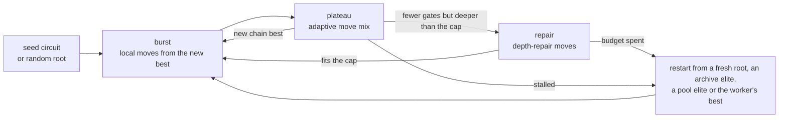
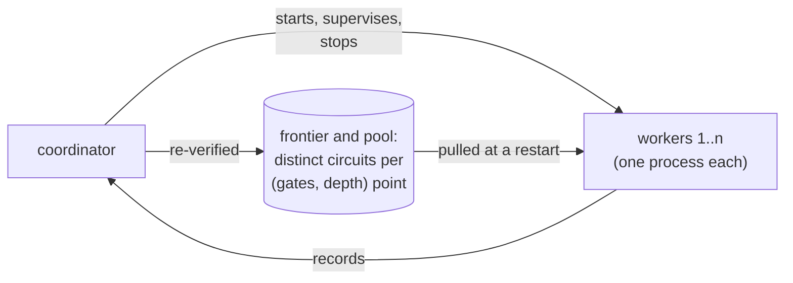
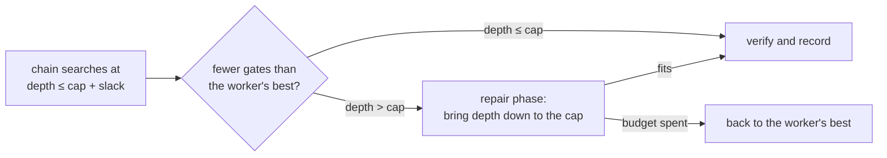

# How XORFlux works (v8)

XORFlux looks for XOR circuits with few gates (then low depth) for GF(2) linear maps. This
page explains the method of the current version, v8. How to run it is in [USAGE.md](USAGE.md); the developer reference
(interfaces, invariants and the evidence behind each default) is
[xorflux/DESIGN.md](xorflux/DESIGN.md).

## A worker: one search chain

Each **worker** runs one search chain: a circuit held as a set of XOR values in an incremental
kernel. Each step picks a move, the move edits the chain, the engine scores the result
(gates, then depth) and keeps it or undoes it. The moves are a remove-and-repair walk, a
destroy-and-rebuild LNS, depth repair, two structural rewrites and, at depth cap 3, a
partition annealer. A chain starts from a seed circuit or from a constructor root: balanced
XOR trees (`naive`), Paar, Boyar–Peralta, or the depth-3 annealer `anneal3`. `anneal3` was
written for depth 3 and is not a general mechanism; circuits it built are marked
([HISTORY.md](HISTORY.md#constructors-and-the-generality-rule)).
An adaptive scheduler gives more time to the moves that pay off.
Neutral steps are always kept and small uphill steps are allowed, so a chain can move along
plateaus. Only the move mix changes between phases, never the loop itself:

**Foundation restarts** are an optional fifth restart source, off by default
(`restart.w_foundation = 0`). A circuit's *level-1 set* is its XORs of two inputs. A
foundation restart keeps the level-1 set of the worker best or an archive elite (optionally
with a few pairs swapped or dropped), builds a fresh root over it, and runs the new chain
pinned: for a fixed number of proposals no other level-1 value can enter, so everything above
level 1 is rebuilt; then the chain continues as usual. The reason is the 2026-11-02
foundations study: on MixColumns at depth 4 the level-1 set largely decides how good a circuit
can get, and the walk changes it only one pair at a time.

## A campaign: many workers

A **campaign** runs many workers under one coordinator. Workers never trust each other: every
circuit a worker records is verified by an independent verifier, and the coordinator verifies
it again before it enters the frontier or the shared pool. Workers take from the pool only
when they restart, so no running chain is ever overwritten by another worker's circuit.

## Depth: a soft cap, then repair

A **soft depth cap** lets a chain search a little deeper than the real cap (`depth_cap`), so
it can remove gates by going through deeper states. Only circuits within the real cap are
ever recorded:

The slack is `objective.soft_depth_slack`. By default it is 1 level for the gates objective,
and 0 when the cap is at or just above the map's minimum depth.

## Polish at the point's own depth

A point recorded below the search cap (and a chain start below it) is first **polished at its
own depth**: a branch and bound removes the largest set of gates that can go while every
output stays within that depth (`engine/polish.py`; exact unless it reaches its node limit,
`engine.record_polish_nodes`). The chain keeps such gates because it works at the deeper
search cap, so this step finds them only once a point is judged at its own depth. Points at
the search cap are not polished.

## Every improvement is explained

Every recorded circuit comes with a **dossier**: the move that produced it, its trace, the
state before and after, and the random state needed to replay it. `verify DIR` re-checks
every record of a run independently. The formats are in
[xorflux/telemetry/schema.md](xorflux/telemetry/schema.md).
