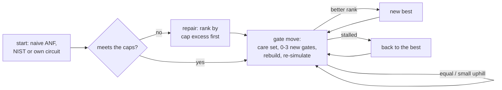
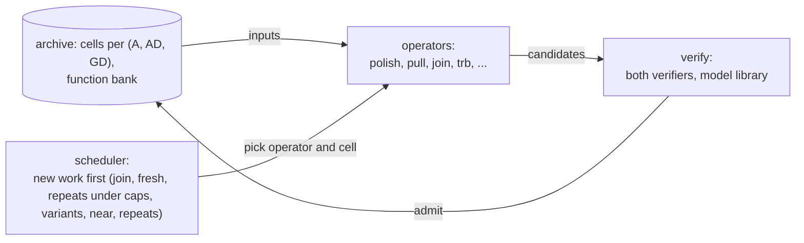

# How BoolFlux works

BoolFlux looks for small circuits of complete Boolean functions, such as S-boxes, over a chosen
gate library: few gates, few AND gates or low depth, under hard caps. This page explains the
method. How to run it is in [USAGE.md](USAGE.md); the developer reference is
[boolflux/DESIGN.md](boolflux/DESIGN.md).

## A circuit with complete truth tables

A circuit is a straight-line program of two-input gates over `n` inputs. Each gate is stored as
its 4-bit truth table, so any two-input function can be in the library (AND, OR, XOR, XNOR,
NAND, NOR, ANDN, ORN, and NOT). Every signal carries its **complete truth table**, `2^n` bits
(4 machine words for an 8-bit S-box), so correctness is never estimated: after every change all
outputs are compared with the target on every input. This limits BoolFlux to about 16 inputs.
XOR-only libraries switch to an exact linear mode.

A **model** is the library plus a cost per gate type. The metrics are G (gates), A (nonlinear
gates), GD (gate depth) and AD (AND depth). The objective is a lexicographic list of up to three
of `cost, g, a, gd, ad`; caps on GD, AD and A are hard.

## The gate move

One move of the gate kernel ([boolflux/kernel/bfx.c](boolflux/kernel/bfx.c)):

1. Pick a gate `s`, flip its truth table and re-simulate what it feeds. The inputs on which an
   output changes are its **care set**; elsewhere `s` may be anything.
2. Look for 0 to 3 new library gates over signals that `s` does not feed (so no cycle can form)
   that equal `s` on the care set: an existing signal, `op(d1, d2)`, `XOR(op(d1, d2), d3)`,
   `op2(op(d1, d2), d3)` or `XOR(op(d1, d2), op'(d3, d4))`, found by hash lookups over pair
   values, and no later than the depth caps allow at `s`.
3. Put it in place of `s`; the gates only `s` needed die. Sweep dead gates, hash equal
   structures, merge gates with identical functions, and re-simulate on all inputs.

The replacement may be an AND of other operands, XORs in place of an AND, or one AND in place of
a cone, so the move changes the **nonlinear structure**, not only the XOR layers around it.

## Acceptance: feasible first

Every candidate is ranked the same way in the kernel, the CLI and the workflows
([boolflux/objective.py](boolflux/objective.py)):

```
rank = (feasible? 0 : 1,  total cap excess,  summed path excess,  key 1,  key 2,  key 3)
```

The best strict improvement is taken; otherwise a random equal candidate (a plateau walk), or,
at a temperature on a sawtooth schedule, a worse one with probability `exp(-delta / T)`, never
more than `max_excess` above the best. After `stall_it` iterations without a new best the chain
returns to its best. A feasible state is never left for an infeasible one. A start that breaks a
cap is **repaired** first, ranked by its total excess, so excess on one cap can be traded for
excess on another on the way; `repair_keep 1` forbids that. A run that never becomes feasible
still writes its best circuit, marked `CAPS NOT MET`. With an iteration budget a run is
deterministic for its seed, settings and code version.



## The AND skeleton

Any circuit is also an **AND skeleton**: K products `g_k = L_k * R_k` of affine forms over the
inputs and earlier products, with every output in their linear span. The skeleton kernel
([boolflux/kernel/skel.c](boolflux/kernel/skel.c)) moves several ANDs at once: it swaps a product
for another that is equal modulo the rest of the span, merges two products into one, or splits
or perturbs one, each checked by Gaussian elimination over complete truth tables. The skeleton
is turned back into gates seeded with the parent circuit, so unchanged parts are copied, and the
gate kernel optimises the result. `cli.py pipe` alternates the two levels. It is what reduces
ANDs on small functions (GF(2⁴) multiplication from 16 to 9). On good AES circuits it costs
gates: changing one AND changes every XOR cone that reads it.

## Moves around the kernel

The gate kernel is a good finisher and a poor explorer: on a mature circuit at its own caps it
finds nothing. The other methods hand it a start it has not seen.

- **Depth pull.** The kernel at one cap lowered (GD by 1-3 with AD free, or AD or A by 1), then a
  polish of what it made.
- **Join at an interface.** The NIST AES circuits compute the GF(2⁴) norm `N = x^17` with their
  first AND level, and those of the Boyar–Peralta family also compute `N^-1` as explicit signals. Where
  two circuits share such functions, a join keeps circuit X up to AND level LX and circuit Y
  above level LY, rebuilds the signals Y reads as affine combinations of X's signals (Gaussian
  elimination), removes dead gates and checks all 256 inputs.
- **GF(2⁸) conjugation and staged pulls.** Inversion commutes with the maps `G(z) = λ z^(2^k)` up
  to another such map, so with `S(x) = A·inv(x) + c` every circuit for S gives 255 × 8 = 2,040
  circuits for S: G on the inputs, an affine correction on the outputs. ANDs and middle layers
  are unchanged; only the top and output layers are re-synthesised. The conjugate is a start,
  usually 10-30 gates worse; staged pulls then run the kernel at a loose GD cap and tighten it
  one or two levels at a time. The screen's proxy predicts the outcome weakly (within-start
  Spearman 0.20, against 0.53 for the first stage's result). Two opt-in alternatives, letting the
  first stage choose (`sh:K`) or a short kernel probe per conjugate (`--sh-probe`), were not
  clearly better than the screen's first choice in paired runs.
- **Transport between the S-box and its inverse.** `S⁻¹ = G′ ∘ Aff⁻¹ ∘ S ∘ G ∘ Aff⁻¹` for each of
  the 2,040 maps G above (Aff the S-box's affine output map), so a circuit for one direction, with
  the maps folded into its first and last linear layers, computes the other with the same ANDs,
  AND depth and middle layers. Staged pulls then remove the gates the folded maps cost. Forward
  circuits gave the inverse its 29/4 and 30/4 families and, from new forward circuits, its 31/5,
  32/5 and 33/4 points; inverse to forward has given nothing (3-15 gates worse).
- **Re-basing level-3 product classes (AND depth 3).** The 12 level-3 products of the AD3
  circuits form three classes of four. Any other basis of a class's operand span keeps every
  output in the span. All 840 bases per class are priced exactly by the Kraft sums of the output
  XOR trees, a depth-feasible circuit is built for the best, and the kernel polishes it. The
  inverse S-box's AD3 circuits have the same classes (its GF(4) coordinates are taken over the
  inversion input A⁻¹y + 0x05); re-basing NIST's 35/3/157/15 at cap 13 gave 35/3/171/13.
  Opt-in options price the bases by an estimate of the built circuit's gate count instead
  (`--price gates`), re-base classes below the top AND level too (`--deep`), which brings
  circuits of AND depth 4 and 5 into reach, and keep every parent gate, redirecting only the
  replaced products (`--patch`); with them re-basing gave the inverse 28/4/131/21 and
  28/4/134/19.
- **Shared-bottom rebuild (many ANDs, low depth).** In the circuits with 41-59 ANDs at GD 10-12
  every output is an XOR of rank-1 products. An annealer chooses per-output decompositions that
  share products, with an exact depth check per output; a builder makes the circuit under the
  kept front, and the kernel polishes it under the same AND count. On the inverse every output
  also carries complemented-operand terms (a Y-sum and an x-form, from the affine inversion
  input). By default they are absorbed into the products, `Y(w + 1) = Yw + Y` and
  `(Y + 1)w = Yw + w`, so they cost no product and no extra term (the forward default keeps such
  terms as fixed terms of the output's XOR tree). From NIST's inverse 45/4/141/12 this gave
  40/4/136/12, better than NIST's in all four metrics, and with a higher weight on ANDs in the
  annealer 39/4/140/12; from NIST's 55/4/148/10 at cap 11, 45/4/143/11.
- **AND removal.** A window of 2-4 ANDs (at most 10 inputs) has a rebuild with one AND fewer only
  if its outputs, modulo the affine functions of its inputs on its care set, span at most
  aW − 1 dimensions. When they do and products of two affine forms span them, the window is
  rebuilt with one AND fewer, exactly; AD and GD may rise. The kernel then polishes the result at
  its own caps and pulls it back to the source's GD. It lowers A at any depth (the shared bottom does so only at GD 11-13): our
  forward 32/4/111/25 became 31/5/112/25, which started the forward 31/5 family (31/5/111/24 to
  31/5/123/17), and our 37/4/127/13 became 36/4/128/13.
- **Direction-select build.** NIST's `aes-sbox-sel` computes the S-box for `c = 0` and the inverse
  for `c = 1`. With the maps of a transport, `S⁻¹(v) = Out(S(In v + c_in)) + c_out`, one forward
  circuit F serves both: `u = v + c·((In + I)v + c_in)`, `w = F(u)`, `y = w + c·((Out + I)w + c_out)`.
  Each product with `c` costs one AND per dimension of the row space of `In + I` and `Out + I`;
  the best maps need 4 + 4, so A = A(F) + 8 and AD = AD(F) + 2 (fewer is not possible in this
  construction). The muxed layers are built gate-cheap (Boyar–Peralta) or depth-aware (balanced
  trees), and kernel polishes under GD caps follow; from our forward circuits this beat 8 of
  NIST's 9 `aes-sbox-sel` Pareto points.
- **Product exchange.** One AND product is replaced by another that is equal to it modulo the
  span of the other products of its level and the signals below, so every output stays in the
  span; the logic that read it is compensated and the kernel polishes the result
  ([boolflux/hub/ops/gf4_lib/prodswap.py](boolflux/hub/ops/gf4_lib/prodswap.py)). Exchanges of
  first-level products gave the AND-depth-3 circuits 35/3/143/18 and 35/3/141/19.
- **Span-pooled SAT LNS.** Circuits with the same AND span share one basis, so their gates are
  templates for each other. A SAT query fixes the current circuit outside a neighbourhood and
  asks for the same gate count (sideways) or one fewer from the pooled templates.

Pull, join, product exchange and AND removal are hub operators ([below](#the-hub)); conjugation,
transport, re-basing, the shared bottom, AND removal, the SAT LNS and the direction-select build
are scripts in [boolflux/ops/](boolflux/ops/). Each works by GF(2)-linear algebra over complete
truth tables. Every circuit the hub admits or a script records is checked by both verifiers
first; the direction-select builder checks its builds with both verifiers on all 512 inputs
([USAGE.md](USAGE.md#checking-and-placing-aes-circuits)).

## The hub

The hub ([boolflux/hub/](boolflux/hub/), contracts in
[DESIGN.md](boolflux/DESIGN.md#46-hub-hub)) is one shared search state per campaign that
every operator reads and writes: an **archive** of verified circuits, kept per cell
`(A, AD, GD)` with the fewest G, so AND count and AND depth are coordinates of their own; a
**function bank** of every signal's truth table; **operators** that own no circuit (`polish`,
`pull`, `join`, `trb` a timing-driven rebuild of one XOR region, `osc` a cap relaxed then
restored, `gen_skel` a skeleton kick then a polish); and a **scheduler** that gives each free CPU
the first new piece of work in a fixed order: joins with circuits not yet met, the first polish and pull
of every new front point, the repeats under the per-point caps, then the first jobs of every other
structure on or near the front, one `trb` per front point, further repeats last (until 2026-11-16 a bandit on recent frontier gain per CPU second, which favoured
short jobs). Nothing enters the archive unverified. Opt-in: the `andrm` operator (AND removal,
polish, pull), a learned scheduler that launches the job with the most predicted front additions
per CPU second, and kernel settings per operator. A hub exhausts the classes it can reach by
recombination in about 1-1.5 hours; after that it pays only when fed new starts.



## Verification

The kernel's re-simulation is a guard against its own bugs. A circuit counts as a result only
after two programs that share no code (`boolflux/core.py` and
[boolflux/independent/verify.py](boolflux/independent/README.md)) accept it on every input,
agree on every metric and confirm the library and the caps. AES circuits are then placed against
NIST's circuits by their recomputed metrics, not their file names
([USAGE.md](USAGE.md#checking-and-placing-aes-circuits)).
