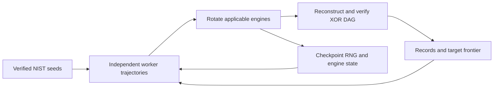

# Three-target XOR search

Python 3.10+, standard library. One process per worker; 20 workers total.

| Target | Inputs → outputs | Seed XORs / depth | Workers |
|---|---:|---:|---:|
| AES S-box bottom | 18 → 8 | 28 / 5; 38 / 4 | 6 |
| FOX Mu4 | 32 → 32 | 130 / 13 | 8 |
| Joltik | 16 → 16 | 44 / 7 | 6 |

Seeds use the [pinned NIST repository](https://github.com/usnistgov/Circuits/tree/8366158a4324ef902ce740f29ddc9f7ebb1018b2), checked 24 October 2026. AES seeds are compatible Boyar–Peralta tails extracted from full S-box circuits; NIST has no separate bottom-layer listing. [Matrices, extraction and attribution](targets/README.md).

Depth starts at zero on every input. AES searches the linear part; its four output complements remain explicit metadata. These metrics do not measure the full S-box.

## Launch

From the repository root, prepare a new campaign, then launch it:

```bash
python3 search/run.py prepare --out search/runs/three-targets20
python3 search/run.py run search/runs/three-targets20
```

Preparation freezes all effective settings, source, matrices and seeds. It starts no workers. Skip preparation if this directory is already prepared. The search runs until stopped; add `--seconds 86400` for a 24-hour session.

```bash
python3 search/run.py status search/runs/three-targets20
python3 search/run.py stop search/runs/three-targets20
python3 search/run.py run search/runs/three-targets20 --resume
python3 search/run.py verify-run search/runs/three-targets20
```

Use `prepare --plan` to inspect the allocation. Add `--pin-cpus` when preparing to assign one available logical CPU per worker. The default refuses oversubscription.

After editing the source, resume with the frozen launcher:

```bash
python3 search/runs/three-targets20/source/search/run.py run search/runs/three-targets20 --resume
```

## Search

Workers rotate through applicable [legacy, inverse, v2 and v3 methods](engines/README.md). Depth caps use the assigned seed depth, one level more, or no cap. Sharing requires the same target matrix and a verified improvement within the receiving worker's cap.



## Saved evidence

| Path inside a campaign | Contents |
|---|---|
| `config.json`, `source.tar.gz`, `source/` | Resolved defaults, seeds, target hashes, commit and exact source bytes |
| `sessions/` | Commands, Python/OS, CPU model, worker allocation and exit status |
| `workers/*/worker.log`, `discoveries.jsonl` | Progress, imports, discoveries and sharing events |
| `workers/*/checkpoint.json` | Current trajectory, each engine's RNG/state, best circuit and frontier |
| `workers/*/records/` | Circuit JSON, NIST-style NCFF, verification and starting RNG evidence |

Equal-quality circuits use an exact DAG hash with fixed inputs/outputs; gate order, temporary names and swapped XOR operands do not create new structures. The default retains up to 32 structures per objective point per worker. Seed imports and shared circuits are labelled separately from discoveries.

Resume restores saved state. Time-limited proposals and concurrent sharing can change trajectories between separate runs, even with the same initial seed.

## Check

```bash
python3 -m unittest discover -s search/tests -p 'test_*.py'
```

[Source notices](NOTICE.md). Campaign output under `search/runs/` stays outside Git and distribution checksums.
