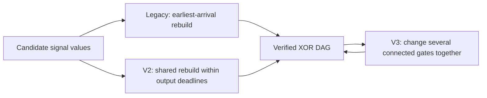

# Generic engine adapters

These are new adapters for arbitrary nonzero linear maps with **1–32 inputs and any positive output count**. Frozen originals remain unchanged. `../engine_api.py` exposes `available_engines`, `effective_knobs`, `engine_applicability` and `run_chunk`.

| Modes | Mechanism and exact lineage | Implementation |
|---|---|---|
| `legacy-walk`, `legacy-lns` | Historical forward value-bank deletion/hub repair and cone destroy/inject/rebuild; inverse `pipeline/engines.py` explicitly ports this family | New bounded, dimension-safe ports in `value_search.py`; fastest-arrival extraction in `common.py` |
| `legacy-constructor`, `legacy-paar` | Historical hunt87 randomized balanced trees and frequency-based Paar contraction | New generic ports in `historical_extra.py` |
| `legacy-bp` | Hunt87 recursive weight-descent distance **upper bound**, sampled pair scoring and norm tie-break | New bounded port; not exact Boyar–Peralta distance |
| `inverse-bp` | Inverse C BP family: distance tiers and constructive population-count/one-hop fallback | New Python port; `exact_tiers=2/3/4`, `distance_fallback=0/1/2`, `norm=none/min/max` |
| `legacy-window` | Historical `exact_window.py` first-unlock anchored resynthesis | New bounded selected-window port; no exhaustiveness/UNSAT claim |
| `legacy-anneal3` | Historical partition annealer and greedy shared pair construction | New disjoint-support partition port; row weights ≤8 |
| `v2-walk`, `v2-lns` | v2 repair expansion plus shared deadline reconstruction | New search loop; reused v2 `reconstruct` |
| `v2-translate`, `v2-cores` | v2 coordinated parent translations and joint triple/quartet cores | Reused `structured_search.py`; explicit target/input arguments |
| `v2-anneal3` | v2 joint finite pair construction for fixed depth-two parents | Generic partition loop; reused `optimize_depth3`; row weights ≤8 |
| `v3-component`, `v3-interface`, `v3-backward` | v3 deliberate collisions, invertible two/three-signal interfaces, backward helper packages | Reused `advanced_moves.propose`; added stop callback |
| `v3-pairbank3` | v3 pair-bank-first mutation and coordinated output split selection | Reused `solve_pair_bank`; row weights **5 or 7** only |

The v2 and v3 code is separately retained. A v3 scheduling flag is never substituted for v2 source. [Source hashes and adaptations](source-manifest.json) identify all reused dependencies and port references.

## Operation



- Applicability checks exclude invalid depth/support models before scheduling. All families also require the ordinary fan-in-two support bound to fit the cap.
- Every emitted candidate is replayed and pruned. The callback is `on_candidate(gates, note=None, metrics=None)`; publication decisions belong to the caller.
- Returned `gates` are the **current trajectory**. JSON state binds target/engine/cap and preserves actual MT19937 state, current/best gates, temperature, iterations and partial construction/pair-bank/partition state. A new seed does not override restored RNG state.
- Cold constructors restart deliberately. Depth-three models first enter their own representation even when a deeper incoming seed uses fewer gates; subsequent proposals use annealing. Best gates remain separately recorded.
- Deadlines and stop hooks bound proposals; symbolic replay and finite bank/catalogue setup add overhead. Checkpoint boundaries do not make time-limited trajectories deterministic across machines.
- `effective_knobs` resolves adapter controls and nested v3 move defaults. Its read-only metadata also records literal kernel signature defaults, actual call overrides and internal call-site values/formulas (including nested reconstruction budgets). These are **new adapter settings**, not historical discovery settings.

## Coverage and limits

```sh
python3 -m unittest search.tests.test_engines -v
python3 -m search.engines.smoke
```

[Real-target smoke results](real-target-smoke.json) verify all applicable modes and JSON resume against the independent target verifier. Synthetic controls require actual gate reductions from component/interface/backward/window moves. Short tests measure execution and correctness, not discovery rates.

- AES-bottom has a weight-12 row; FOX has weight-10 rows. Depth-three constructors are excluded there. Joltik fits both partition and pair-bank models.
- MixColumns byte rotations, specialized orbit/K3 constructions, matrix-specific proof obstructions and forward-to-inverse output-basis identities are not applied to these targets.
- The original C BP exact five/six-sum tiers, lookahead/endgame DFS and shared-best scheduling variants are deferred expensive subroutines; this port does not claim executable equivalence to each C revision. Its exact tiers and fallback policy are explicit.
- Historical closure/fixpoint/BFS implementations compute the same reachability/arrival relation and are represented by one generic family. Failed bounded searches imply neither optimality nor impossibility.
